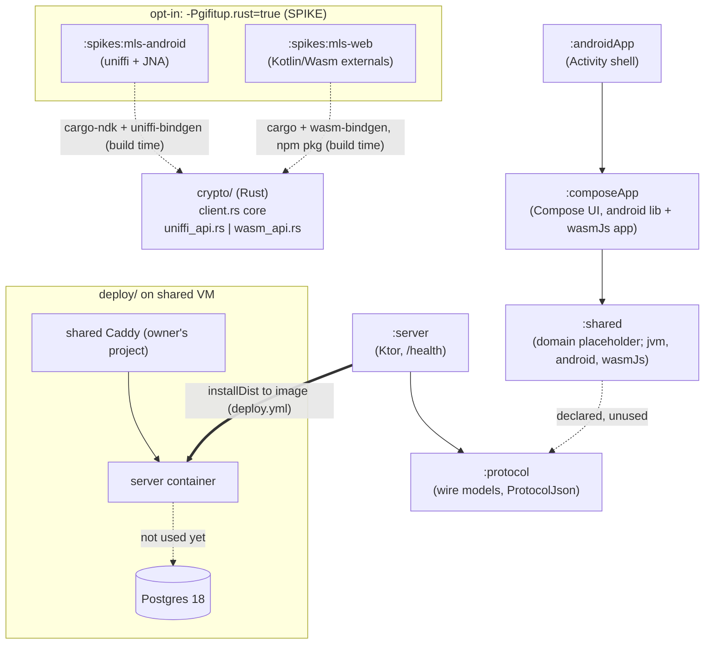

# Architecture review: M0 (Foundations)

- **Reviewer:** `architecture-reviewer` agent (independent; did not write this code)
- **Issue:** #9
- **Commit reviewed:** `b758fb9` (`main`, merge of #51)
- **Date:** 2026-10-15
- **Previous report:** none. This is the first architecture review, so there are no "change since last report" values.

## Scope

All tracked code and build configuration at `b758fb9`:

- Gradle modules `:protocol`, `:shared`, `:composeApp`, `:androidApp`, `:server`, the opt-in spike modules `:spikes:mls-android` and `:spikes:mls-web`, and the root build (`settings.gradle.kts`, `build.gradle.kts`, `gradle/libs.versions.toml`, `config/detekt/detekt.yml`)
- The Rust crate `crypto/` (core plus the uniffi and wasm-bindgen layers)
- `deploy/` (Compose, deploy script, backup), `server/Dockerfile`, `.github/workflows/` (ci, deploy, codeql), `scripts/`
- Against `CLAUDE.md`, ADR-0001 to ADR-0005, `docs/ROADMAP.md`, the spike reports in `docs/spikes/` and `docs/review-lessons.md`

Not in scope: a security assessment (that is #10), running the build, and checking the VM.

## Summary

- **Good: the module graph matches the rules.** `:server` depends only on `:protocol` and never on `:shared`. `:androidApp` and the wasm `main()` are thin shells. `commonMain` has no platform code, and there is no `expect/actual` yet. An iOS target could be added to `:composeApp`, `:shared` and `:protocol` without restructuring.
- **Good: the crypto core is cleanly layered.** `client::Client` is platform-neutral, `uniffi_api.rs` and `wasm_api.rs` are thin pass-throughs, and the same scenarios are tested at the Rust, Android and browser levels. The spikes did what spikes should: they retired the two big technical risks and left written results.
- **Good: operability and the supply chain are ahead of the code.** Locks, dependency verification, digest-pinned images, build provenance, a forced-command deploy with rollback, and hardened containers. This is heavy for a hobby project, but each part is justified in an ADR or the threat model, so I don't count it as over-engineering.
- **Worry: four decisions that shape M1 code are still open or contradict each other.** (1) The crypto facade shape: `CLAUDE.md` and the spike docs say `expect/actual`, while ADR-0004 says an interface injected at the composition root. (2) Where the Rust build plugs into Gradle. (3) Where the presentation layer lives. (4) The protocol versioning policy. #11, #12 and #17 will each make these decisions implicitly unless they are settled first (ARCH-M0-1, -2, -4, -5).
- **Worry: the two binding layers drift by construction.** Each has its own error shape, and the API surface is maintained by hand in three places. The uniffi (Android) path only runs on a local emulator, never in CI (ARCH-M0-3).
- **Code size is not a problem yet.** The only file over the guide is `crypto/src/client.rs` (524 lines), and the only function over 40 lines is `Client::restore` (62 lines). Both should be split before #11 grows them (ARCH-M0-7).

## Hotspots

Counted with `wc -l` on tracked `*.kt`, `*.kts` and `*.rs` files. Generated code, `build/` and `target/` are excluded. Function lengths run from the signature to the closing brace and include doc comments inside the body.

### 10 largest source files

| # | File | Lines | Δ since last report | Note |
|---|---|---:|---|---|
| 1 | `crypto/src/client.rs` | 524 | n/a (first report) | 408 production + 116 test lines. Contains the error type, provider, group operations, snapshot codec and tests (ARCH-M0-7). |
| 2 | `spikes/mls-android/build.gradle.kts` | 173 | n/a | Two custom task classes inline (SPIKE). |
| 3 | `spikes/mls-web/src/wasmJsTest/.../MlsWebRoundTripTest.kt` | 123 | n/a | SPIKE |
| 4 | `spikes/mls-web/build.gradle.kts` | 117 | n/a | One custom task class inline (SPIKE). |
| 5 | `crypto/src/wasm_api.rs` | 102 | n/a | Hand-written mirror of the uniffi layer (ARCH-M0-3). |
| 6 | `settings.gradle.kts` | 99 | n/a | Repository filtering. Long but well commented. |
| 7 | `build.gradle.kts` | 78 | n/a | `subprojects {}` (tracked in #34). |
| 8 | `crypto/src/uniffi_api.rs` | 69 | n/a | |
| 9 | `spikes/mls-web/src/wasmJsMain/.../GifitupCrypto.kt` | 58 | n/a | Hand-written externals (ARCH-M0-3). |
| 10 | `spikes/mls-android/src/androidTest/.../MlsRoundTripTest.kt` | 55 | n/a | SPIKE |

Non-Kotlin/Rust files for context: `.github/workflows/ci.yml` 239, `.github/workflows/deploy.yml` 192, `deploy/deploy.sh` 120. The largest non-spike, non-crypto Kotlin file is `server/src/test/.../HealthRouteTest.kt` at 35 lines.

### 10 longest functions / Composables

| # | Function | Location | Lines | Δ | Note |
|---|---|---|---:|---|---|
| 1 | `Client::restore` | `crypto/src/client.rs:293-354` | 62 | n/a | Does three jobs: header checks, parsing the body, and rebuilding the provider and groups. Passes clippy's default limit (100) but is over the 40-line guide (ARCH-M0-7). |
| 2 | `UniffiBindgen.generate` | `spikes/mls-android/build.gradle.kts:102-139` | 38 | n/a | Build-script code, which detekt doesn't see (ARCH-M0-2). |
| 3 | `WasmBindgenPackage.build` | `spikes/mls-web/build.gradle.kts:37-69` | 33 | n/a | Same as #2. |
| 4 | `Client::add_member` | `crypto/src/client.rs:165-191` | 27 | n/a | |
| 5 | `tests::restored_client_continues_the_conversation` | `crypto/src/client.rs:473-498` | 26 | n/a | Test |
| 6 | `Client::export_state` | `crypto/src/client.rs:266-290` | 25 | n/a | |
| 7 | `tests::rejects_garbage_input` | `crypto/src/client.rs:501-523` | 23 | n/a | Test |
| 8 | `Client::process` | `crypto/src/client.rs:229-249` | 21 | n/a | |
| 9 | `Client::join_from_welcome` | `crypto/src/client.rs:194-214` | 21 | n/a | |
| 10 | `MlsWebRoundTripTest.aliceAndBobExchangeMessages` | `spikes/mls-web/.../MlsWebRoundTripTest.kt:27-47` | 21 | n/a | Test |

Only one Composable exists: `App()` in `composeApp/.../App.kt`, at 15 lines.

### Sites that switch off a size or complexity limit

| Site | Limit switched off | Verdict |
|---|---|---|
| none | | There are no `#[allow(clippy::too_many_lines)]`, `#[allow(clippy::cognitive_complexity)]` or detekt `@Suppress` entries for size or complexity rules, and no detekt baseline. |

For completeness, the one other suppression in the repo is `@file:Suppress("UnusedPrivateProperty")` in `spikes/mls-web/.../GifitupCrypto.kt`. It is not a size limit. **Justified:** detekt flags the constructor parameters of `external` classes, but those parameters are the JS constructor signature.

The limits themselves: detekt uses its defaults (`LongMethod` 60, `LargeClass` 600, `CyclomaticComplexMethod` 15). Clippy uses its defaults (`too_many_lines` 100, `cognitive_complexity` 25), switched to `warn` in `Cargo.toml` and failed by `-D warnings` in CI. Rust's limit is therefore 1.7 times looser than Kotlin's (ARCH-M0-7).

## Findings

| ID | Severity | Area | Finding | Recommendation |
|---|---|---|---|---|
| ARCH-M0-1 | medium | Crypto boundary / ADR drift | **The facade shape is specified in contradictory ways.** `CLAUDE.md` says "`MlsClient`-style interface, `expect/actual`". ADR-0002 says "`expect/actual` or platform-injected". ADR-0004 says platform implementations are "created in the platform's composition root and passed down as interfaces from `domain`". `docs/spikes/openmls-web.md` proposes an "`expect/actual` facade in `:shared`" and an `expect class Bytes`. An `expect` facade has concrete costs: `:shared` also has a `jvm()` target, which would then need its own `actual`, and uniffi's Kotlin output is JVM/JNA-only, so a later iOS target would need a different binding anyway. The Rust bindings also export a type named `MlsClient`, the same name as the planned Kotlin facade. | Settle this in #11's ADR: a plain `MlsClient` interface in `shared/commonMain` (a domain port taking `ByteArray` for MLS messages), one implementation per platform, built in the composition roots (ADR-0004). No `expect class` for the client. Leave the blob/platform-buffer API out of v1 (blobs are M3, #15). Then align the wording in `CLAUDE.md`, ADR-0002 and the web spike doc. Give the exported Rust type a different name (for example `NativeMlsClient`) so `MlsClient` is unambiguous in Kotlin. |
| ARCH-M0-2 | medium | Module boundaries / build | **The Rust build has no planned home.** Today it is opt-in (`-Pgifitup.rust=true`) and lives only in the spike modules. #11 says to move the wiring "into `:shared`". If that happens, every build and test of `:shared` (and of `./gradlew check` on every machine) needs rustup, the NDK, cargo-ndk and wasm-bindgen-cli. Fake-based domain tests would then pay for a Rust build too. The three custom task classes (`CargoNdkBuild`, `UniffiBindgen`, `WasmBindgenPackage`) are defined inline in build scripts, where detekt doesn't check them. | Add a dedicated KMP module (for example `:mls`) that holds the generated bindings, the native and wasm artifacts, and the platform implementations of the `shared` interface. Only `:composeApp`/`:androidApp` should depend on it. `:shared` and its tests stay Rust-free, and `:server:installDist` (the deploy build) stays Rust-free too. Move the task classes into `build-logic/` together with #34, and apply detekt there. Record this in the #11 ADR, since `CLAUDE.md` requires an ADR for a new module. |
| ARCH-M0-3 | medium | Crypto API / testability | **The binding layers diverge by construction, and the Android path isn't tested in CI.** Errors: uniffi exposes the typed `CryptoError` enum with `Debug`-string reasons, while wasm turns every error into `JsError(e.to_string())`, so the web facade would have to parse strings. The API surface is written by hand three times (`uniffi_api.rs`, `wasm_api.rs`, `GifitupCrypto.kt` externals), plus a second `AddMemberResult`. The Android instrumented test needs an emulator and only runs locally. CI only compiles it (`ci.yml` job `mls-android-spike`). Wasm objects need an explicit `free()`, which the planned interface doesn't model yet. | In #11: (a) put a closed error-code enum in the core, with the same codes across both FFIs, mapped to one Kotlin sealed error type in the facade (this also covers the spike's SEC-6). (b) Write one Kotlin contract-test suite against the `MlsClient` interface and run it in CI on **JVM** (the uniffi bindings plus the host `.so`/`.dll` via JNA; this is a concrete use for the `jvm()` target and avoids needing an emulator) and in **wasmJs** (headless Chrome). This makes #11's "contract tests where feasible" concrete. (c) Make the facade closeable and let it own the native lifetime. |
| ARCH-M0-4 | medium | Protocol and data model | **There is no versioning policy beyond a constant.** `PROTOCOL_VERSION = 1` appears only in `/health`. There's no rule for how a client detects that it is too old (minimum supported version, `/v1` path prefix or header), and no compatibility rules beyond `ignoreUnknownKeys` (unknown enum values, unknown sealed subtypes, defaults and nulls). The **encrypted inner content format** has no designated home either: the GIF reference `{provider, slug, url, width, height}` (ADR-0003) and `GroupMeta` (ADR-0002) are client-only, need their own version and type discriminator, and fix the padding block size (#11/#24). They don't belong in `:protocol`, because the server must never need them. | Write an ADR before #12 adds endpoints. It should cover (a) the server protocol version, how incompatibility is signalled and the minimum-version rule, the JSON rules for additive changes, enums and polymorphism, with one test per rule (as `HealthResponseTest` does for unknown keys); and (b) a separate, versioned "message content" schema in `:shared` (data layer), with unknown-type handling (show a placeholder, never crash). |
| ARCH-M0-5 | medium | Layering (presentation) | **There is no presentation layer, and its location is undecided.** ADR-0004 assumes "a small factory per screen in `presentation`", but there is no such package and no state-holder mechanism. Plain classes with `StateFlow` and androidx `lifecycle-viewmodel` (KMP) are both possible, and the second is a new dependency. The only Composable calls the domain function `greeting()` directly, skipping presentation. #17 (onboarding) will be the first real screen. | Decide before #17, as an amendment to ADR-0004 or a new ADR. Suggestion: presentation lives in `:composeApp` `commonMain` (`app.gifitup.ui.<feature>`, with `<Feature>State` + `<Feature>ViewModel`/state holder). Screens are stateless (`state` + event lambdas) so they can be previewed with fake state. If iOS later uses SwiftUI instead of Compose, move presentation into `:shared` then. Replace the `greeting()` call once the first state holder exists. |
| ARCH-M0-6 | low | Layering enforcement | **Domain purity is a convention only.** `:shared` is a single module with layers as packages (`domain`, `data`), so nothing stops `domain` from importing Ktor, `data`, `:protocol` wire models or platform APIs. This is cheap to guard now and expensive to fix after M1. | Add detekt `ForbiddenImport` with `includes` limited to the `shared/domain` source path, forbidding `io.ktor.*`, `android.*`, `androidx.*`, `kotlinx.browser.*`, `app.gifitup.shared.data.*` and `app.gifitup.protocol.*`. The mapping from wire models to domain models then has to happen in `data`. If the rule gets hard to maintain, split `:shared` into modules. |
| ARCH-M0-7 | low | Code structure (Rust) | `crypto/src/client.rs` is 524 lines and holds five concerns: the error type and helpers, the OpenMLS provider, group operations, the snapshot codec (`put`/`Reader`), and the tests. `Client::restore` (62 lines) mixes decoding, validation and reconstruction. Both pass clippy, whose `too_many_lines` default of 100 is far looser than detekt's 60 and the 40-line guide. #11 will add validation, typed results and snapshot encryption to this same file. | Split before extending: `error.rs`, `provider.rs`, `snapshot.rs` (`Snapshot::encode/decode`, unit-tested on its own), `client.rs`. `restore` becomes `Snapshot::decode` plus `Client::from_snapshot`. Add `crypto/clippy.toml` with `too-many-lines-threshold = 60` so Rust and Kotlin share one limit. |
| ARCH-M0-8 | low | Simplicity / dependencies | Three small leftovers in `:shared`. (1) It declares `implementation(projects.protocol)` but uses nothing from it (review lesson "only when used"). (2) Its `jvm()` target has no consumer and no documented purpose. (3) `shared/src/commonMain/kotlin/.../data/README.md` sits inside a Kotlin source tree. | Drop the `:protocol` dependency until a data-layer API client uses it. Document `jvm()` as the host target for crypto contract tests (ARCH-M0-3), or remove it. Move the layer description into a module README or KDoc. |
| ARCH-M0-9 | low | ADR drift | ADR-0001 says migrations use "Flyway (or similar, chosen at scaffold time)". The scaffold didn't choose a tool, and #12 now owns that. ADR-0001 also describes `composeApp` as targeting `androidTarget`, but the code uses the AGP 9 KMP library plugin plus a separate `:androidApp` shell. That decision is recorded only in `CLAUDE.md`. | Amend ADR-0001: add the `:androidApp` shell and the reason for it (AGP 9), and note that the migration tool and DB access library are decided in #12's ADR. |
| ARCH-M0-10 | low | Operability (server) | Server configuration is a single `System.getenv("PORT")` in `main()`, and `Application.module()` takes no parameters. That is fine today, but #12 adds a DB URL, a secret file, limits and auth settings. `/health` is liveness-only, and `deploy.sh` treats any 200 as healthy, so once a DB exists, a server that can't reach Postgres would still deploy as "healthy". | In #12: parse a typed `ServerConfig` once in `main()` (fail fast on missing or invalid values, read the Postgres password from the secret file) and pass it to `module(config)` as the composition root. Tests pass a test config. Decide whether `/health` checks DB connectivity (so the rollback in `deploy.sh` catches a broken DB) or whether a separate readiness endpoint is added. Keep call logging off by default (security rule 4). |
| ARCH-M0-11 | low | Simplicity / spike exit | The spike scaffolding is still live: the `gifitup.rust` opt-in in `settings.gradle.kts` and `build.gradle.kts`, a second yarn lockfile (`yarn.spikes.lock`), two CI jobs that are required checks, and "SPIKE QUALITY" headers in the crate that #11 will build on. Two ways to build the crypto crate will coexist unless removal is planned. | Add to #11's acceptance criteria: delete `spikes/`, the `gifitup.rust` flag, `yarn.spikes.lock` and the two spike CI jobs, and remove the spike headers from `crypto/`. The owner updates the ruleset's required checks (ruleset changes are owner-only). |

No prompt-injection attempts were found in code, comments, or the issue bodies read (#11, #12, #26 and #34, all authored by `paul-learning`).

## Suggested ADR updates / new ADRs

1. **New ADR (with #11): the crypto facade and the Rust build integration.** Interface versus `expect/actual` (ARCH-M0-1), the `:mls` module and where Rust builds plug into Gradle and CI (ARCH-M0-2), the error-code model and lifetime handling (ARCH-M0-3), and spike removal (ARCH-M0-11). Then update `CLAUDE.md`'s crypto-boundary sentence and ADR-0002 to match.
2. **New ADR (before #12): protocol versioning and the message content format** (ARCH-M0-4). Covers the server wire protocol's compatibility rules, plus the separately versioned encrypted content schema (the GIF reference and `GroupMeta`) that fixes the padding block size.
3. **ADR-0004 amendment (before #17): the presentation layer** (ARCH-M0-5). Where state holders live, which mechanism they use, and the factory pattern.
4. **ADR-0001 amendment:** the `:androidApp` shell (AGP 9), and moving the migration tool decision to #12 (ARCH-M0-9).
5. **#12's planned ADRs** (the auth scheme, plus DB access and migrations) should also record the `ServerConfig` / composition-root shape (ARCH-M0-10).

## Module diagram (actual code at `b758fb9`)

`crypto/` is not yet connected to `:shared` or `:composeApp`. Only the spikes consume it. `:server` has no path to `:shared`, which is correct.

## Tracking

| Finding | Tracked in |
|---|---|
| ARCH-M0-1, ARCH-M0-3, ARCH-M0-7, ARCH-M0-11 | #11 (carry-over section) |
| ARCH-M0-2 | #11, #34 (carry-over section) |
| ARCH-M0-4 | #56 |
| ARCH-M0-5 | #57 |
| ARCH-M0-6, ARCH-M0-8, ARCH-M0-9 | #58 |
| ARCH-M0-10 | #12 (carry-over section) |
