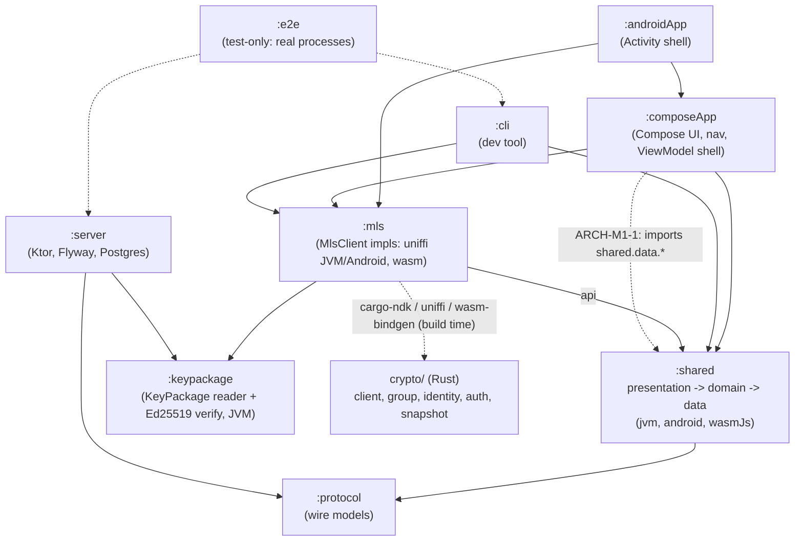

# Architecture review: M1 (Identity, accounts, invites, KeyPackage directory, onboarding, contacts)

- **Reviewer:** `architecture-reviewer` agent (independent; did not write this code)
- **Issue:** #19
- **Commit reviewed:** `e7c61ae` (branch `docs/19-m1-reviews`, from `main` at `bc86c71`, PR #153 merged; the code is identical to `main`)
- **Date:** 2026-10-24
- **Previous report:** `docs/reviews/2026-10-15-m0-architecture.md` (`b758fb9`)

## Scope

All tracked code and build configuration: Gradle modules `:protocol`, `:keypackage`, `:shared`, `:mls`, `:composeApp`, `:androidApp`, `:server`, `:cli`, `:e2e`; the Rust crate `crypto/`; `deploy/`, `.github/workflows/` (ci, deploy, codeql) and `scripts/` by structure only. Checked against `CLAUDE.md`, ADR-0001 to ADR-0014, `docs/ROADMAP.md`, `docs/review-lessons.md` and the M0 report. Not in scope: a security assessment (the M1 security review), running the build, the VM. Sizes counted with `wc -l` and a brace-matching script over tracked `*.kt`, `*.kts`, `*.rs` (generated code, `build/`, `target/` excluded); function lengths run from signature to closing brace and are approximate (+-2).

## Summary

- **Good: all eleven M0 findings are closed or resolved by design.** One `MlsClient` interface in `:shared` (no `expect class`; `grep` finds no `expect`/`actual` in `shared`, `composeApp` or `mls/commonMain`), a dedicated `:mls` module that only the apps and the CLI depend on, ADR-0006 (versioning) and ADR-0013 (presentation), a typed `ServerConfig`, a DB-aware readiness `/health`, `ForbiddenImport` allow-list on `shared/domain`, the spikes gone, `client.rs` split from 524 to 299 lines, `clippy.toml` with `too-many-lines-threshold = 60` (the same limit as detekt's).
- **Good: the module graph is clean and enforced.** `:server` depends on `:protocol` and `:keypackage` only; `:shared` imports `:protocol` only in `data/network`; `data` imports nothing from `domain` or `presentation`; domain code imports only Kotlin, coroutines and `shared.{domain,data}`. Wire models are separate from domain models. Migrations are Flyway (V1 to V3) with separate Migrate/Admin entry points and a `MigrationsTest`. The end-to-end test runs real Migrate, server and CLI processes inside `check`.
- **Good: size discipline held.** No Rust or Kotlin production function is over 68 lines (most under 50); the longest are one Composable (`Navigation`, 68) and a handful of 46 to 51-line functions. No size/complexity suppression is unjustified, and no detekt baseline and no `#[allow(clippy::...)]` exist.
- **Worry: the `ui` package of `:composeApp` has grown a data-layer composition root and leaks `data.*` types.** `OnboardingViewModel` builds the engine, `GifItUpApi`, `DeviceAuth` and three feature holders, and has outgrown its name. Six files in `ui/` and `AppGraph.kt` import `shared.data.*` directly (ARCH-M1-1).
- **Worry: the Composable layer is untested and partly logic-bearing.** `composeApp` has no test source set and no previews. `App.kt` (`Configured`, `Navigation`) does storage loading, error mapping and ViewModel wiring inside Composables (ARCH-M1-3).
- **Worry: build logic is the largest unlinted code.** `mls/build.gradle.kts` (531 lines, six task classes) is the biggest source file in the repo outside tests, and `androidApp/build.gradle.kts` is 303 lines. Detekt does not see either; M0's ARCH-M0-2 recommended `build-logic/` and it was not done (ARCH-M1-2).

## M0 carry-over status

| M0 finding | Status at `e7c61ae` |
|---|---|
| ARCH-M0-1 facade shape | Closed. ADR-0007; plain interface `data.crypto.MlsClient`, `MlsClientFactory` in the composition roots. |
| ARCH-M0-2 Rust build home | Partly closed. `:mls` exists and `:shared`/`:server` are Rust-free. The task classes are still inline in a build script (ARCH-M1-2). |
| ARCH-M0-3 binding drift / CI | Closed for CI: `MlsClientContractTest` in `commonTest`, run in `:mls:jvmTest` (uniffi over the host library) and `:mls:wasmJsTest`; `.so` build and APKs in the CI job `MLS bindings`. Android instrumented tests are still not run in CI (accepted: the JVM run covers the same uniffi layer). |
| ARCH-M0-4 versioning | Closed. ADR-0006, header-based range, strict parsing, content schema in `shared`. |
| ARCH-M0-5 presentation | Closed, with a different location than suggested: state holders in `:shared/presentation` (ADR-0013), Compose in `:composeApp`. See ARCH-M1-1 for the cost. |
| ARCH-M0-6 domain purity | Closed. Stricter than suggested (allow-list). The domain-to-data dependency is allowed by owner decision on #133; that decision is recorded in ADR-0004 (*Interfaces from data*) and in a `detekt.yml` comment, but ADR-0004 does not say what "pure domain" now means (ARCH-M1-4). |
| ARCH-M0-7 `client.rs` split | Closed. Now `error`, `provider`, `snapshot`, `group`, `identity`, `auth`, `fingerprint`, `client`. |
| ARCH-M0-8 leftovers | Closed. `shared` uses `:protocol`; `jvm()` serves the CLI and `jvmTest`. |
| ARCH-M0-9 ADR-0001 | Closed (Amendments section). |
| ARCH-M0-10 server config | Closed. `ServerConfig`, readiness behind `/health` (503 when the DB is unreachable). |
| ARCH-M0-11 spikes | Closed. `spikes/` and the opt-in flag are gone. |

## Hotspots

### 10 largest source files

| # | File | Lines | Δ since M0 | Note |
|---|---|---:|---|---|
| 1 | `server/src/test/.../keypackages/KeyPackageEndpointsTest.kt` | 593 | new | Test; many cases per route. |
| 2 | `crypto/src/identity.rs` | 593 | new | 206 production + 387 test lines (tests start at line 207). |
| 3 | `mls/build.gradle.kts` | 531 | new | Build script with six inline task classes (ARCH-M1-2). The largest non-test source file. |
| 4 | `server/src/test/.../auth/AuthEndpointsTest.kt` | 504 | new | Test. |
| 5 | `shared/src/commonTest/.../contacts/ContactsStateHolderTest.kt` | 484 | new | Test. |
| 6 | `crypto/src/auth.rs` | 452 | new | 179 production + 273 test (incl. a 45-line vectors helper). |
| 7 | `e2e/src/test/.../EndToEndTest.kt` | 438 | new | One class, a scenario per helper; fine. |
| 8 | `server/src/test/.../invites/InviteEndpointsTest.kt` | 436 | new | Test. |
| 9 | `shared/src/commonMain/.../data/network/GifItUpApi.kt` | 415 | new | **Largest production Kotlin file; over the 400 guide** (ARCH-M1-6). |
| 10 | `crypto/src/snapshot.rs` | 409 | new (was part of `client.rs`, 524) | 258 production + 151 test. |

Largest production Kotlin files after #9: `ContactBook.kt` 362, `ContactsStateHolder.kt` 357, `cli/.../Cli.kt` 356, `AuthService.kt` 322, `androidApp/build.gradle.kts` 303, `KeyPackageService.kt` 296, `Repositories.kt` 289 (three repositories in one file). Change since M0: M0's largest file (`crypto/src/client.rs`, 524) is now 299 lines; the repo grew from ~30 to 237 tracked Kotlin/Rust files and ~30,800 lines (about 60 percent of them tests).

### 10 longest functions / Composables (production code)

| # | Function | Location | Lines | Δ | Note |
|---|---|---|---:|---|---|
| 1 | `Navigation` (Composable) | `composeApp/.../ui/App.kt:120` | 68 | new | Nav graph, ViewModel lookup and origin-change handling in one function (ARCH-M1-3). |
| 2 | `bootstrapRoles` | `server/.../db/Migrations.kt:75` | 51 | new | SQL role bootstrap; linear. |
| 3 | `CreateInviteScreen` (Composable) | `composeApp/.../ui/CreateInviteScreen.kt:37` | 51 | new | Renders state; lifecycle effects inline. Acceptable. |
| 4 | `Route.inviteRoutes` | `server/.../invites/InviteRoutes.kt:27` | 49 | new | Four routes in one block; typical Ktor routing. |
| 5 | `KeyPackageReader.parse` | `keypackage/.../KeyPackageReader.kt:81` | 49 | new | Linear parser, suppressed on purpose (see below). |
| 6 | `FriendsScreen`'s `Review` (Composable) | `composeApp/.../ui/FriendsScreen.kt:97` | 46 | new | Renders the review state. |
| 7 | `Configured` (Composable) | `composeApp/.../ui/App.kt:64` | 46 | new | Loads storage, catches `LocalStateException`, picks a screen: logic in a Composable (ARCH-M1-3). |
| 8 | `Texts.api` | `composeApp/.../ui/Texts.kt:91` | 42 | new | Exhaustive `when` over a closed code; suppressed. |
| 9 | `ContactsStateHolder.openReview` | `shared/.../presentation/contacts/ContactsStateHolder.kt:223` | 42 | new | Hits the 40 guide; mixes loading, comparison and state building. |
| 10 | `AuthService.createOrResume` | `server/.../auth/AuthService.kt:201` | 41 | new | Registration/resume decision tree; documented in ADR-0009. |

Rust production: `Client::restore` from M0 (62 lines) is gone. The longest Rust production functions are now under 45 lines; the longest Rust functions in the repo are tests or helpers (`identity.rs::inspect_rejects_what_must_not_be_used` 46, `auth.rs::vectors_json` 45, `group.rs::forgetting_a_group_leaves_no_secrets_behind` 44). Longest test functions: `validlySignedVariants` 63, `buildKeyPackage` (test fixture) 54, `ContactsStateHolderTest` cases 54 and 45. No finding for tests.

### Sites that switch off a size or complexity limit

No `#[allow(clippy::too_many_lines)]`, no `cognitive_complexity` allow, no detekt baseline, and no `LongMethod`/`LargeClass` suppression. The size-related suppressions are:

| Site | Limit | Verdict |
|---|---|---|
| `GifItUpApi` (`GifItUpApi.kt:58`) | `TooManyFunctions` | Justified today (12 endpoint functions over one `exchange`); but at 415 lines the file should be split (ARCH-M1-6), which would make the suppression unnecessary. |
| `ContactBook` (`ContactBook.kt:74`) | `TooManyFunctions` | Borderline. 21 functions, 362 lines: a trust-policy object (rules of ADR-0014) with storage-free logic. Justified as one value type, but it is domain logic sitting in `data` (ARCH-M1-4). |
| `ContactsStateHolder` (`ContactsStateHolder.kt:104`) | `TooManyFunctions` | Justified: one screen's actions, 357 lines. Watch it; the next feature should split review handling out. |
| `ContactsStateHolder` (`:69`), `RegisterDevice` (`:40`), `AuthService` (`:70`), `Application.kt` (`:109`, `:120`), `OnboardingScreen` (`:31`), `AuthEndpointsTest` (`:116`) | `LongParameterList` | Constructor injection and composition root: justified. `OnboardingScreen` (state, holder and one callback per destination) is the only one that should become a small `Destinations` holder. |
| `Texts.api` (`Texts.kt:71`), `Cli.kt:317` and `:336` | `CyclomaticComplexMethod` | Justified: one fixed string per closed error code, exhaustive `when`. |
| `KeyPackageReader.parse` (`KeyPackageReader.kt:80`) | `CyclomaticComplexMethod` | Justified: a straight pass over a fixed binary layout; protected by a differential test against the Rust parser. |

File-level suppressions: `WebDatabase.kt:1` (`TooManyFunctions`, one small `js()` helper per IndexedDB call: justified), `WasmInterop.kt:1`, `KeyPackageRepository.kt:1`, `MemberRepository.kt:1`, `Repositories.kt:2` and `InviteRepository.kt:2` (comments give the reason), `GifitupCrypto.kt:3` and `GifitupCryptoTest.kt:3` (`UnusedPrivateProperty`; reason in the line above). `KeyPackageBuilder.kt:1` (test fixture; `MagicNumber`, `LongParameterList`, `CyclomaticComplexMethod`, `MatchingDeclarationName`) is the one file-level suppression **without a stated reason**: add one (a byte-layout builder, as the reader's `CyclomaticComplexMethod`). Other non-size suppressions (`TooGenericExceptionCaught`, `UnusedParameter` on `js()` bodies, `UNCHECKED_CAST`) carry a reason and are consistent. `SwallowedException` on `WasmMlsClient`/`UniffiMlsClient` is deliberate (error text must not carry secrets).

## Findings

| ID | Severity | Area | Finding | Recommendation |
|---|---|---|---|---|
| ARCH-M1-1 | medium | Layering / cohesion | **The `ui` package is a composition root and sees the data layer.** `composeApp/.../ui/OnboardingViewModel.kt` builds the HTTP engine, `GifItUpApi`, `DeviceAuth`, `SessionHolder` and three feature holders (onboarding, create-invite, contacts), so a class named for one screen owns the whole per-origin object graph, and the Invites/Friends routes fetch it with `getBackStackEntry(ROUTE_ONBOARDING)`. Six files in `ui/` and `AppGraph.kt` import `shared.data.*` directly (`ApiError`, `GifItUpApi`, `ApiEndpoint`, `Invite`, `InviteState`, `TrustConflict`, `FingerprintEmoji`, `LocalStateException`, `MlsClientFactory`), so `ui` depends on data types, not only on presentation view types. Each new feature (M2: chats) will add another holder here. | Rename it `OriginScope`/`OriginSession` and move the construction into a factory in `shared/presentation` (the CLI and tests can reuse it; `ui` keeps only the `ViewModel` shell that calls `onCleared`). Expose view types for what the screens render (`InviteView` instead of `Invite`/`InviteState`, a presentation enum for `TrustConflict`/`ApiError` texts), and add a detekt `ForbiddenImport` for `composeApp/**/ui/**` against `app.gifitup.shared.data.*` (allow `MlsClientFactory` in `AppGraph` only). Amend ADR-0013 with the rule. |
| ARCH-M1-2 | medium | Build / simplicity | **Build logic is the largest code that no linter sees.** `mls/build.gradle.kts` is 531 lines with six task classes (`CargoSerializer`, `UniffiBindgen`, `CargoNdkBuild`, `CargoHostTestLibrary`, `VerifyNoTestPanic`, `WasmBindgenPackage`) plus test wiring; `androidApp/build.gradle.kts` is 303 lines with `VerifyManifestHardening`. M0 recommended moving these to `build-logic/` with #34; it is still open. The security-relevant checks (`VerifyNoTestPanic`, manifest hardening) are therefore unit-untested and unlinted code. | Create `build-logic/` (included build) with the task classes as plain Kotlin, apply ktlint/detekt to it, and keep the two build scripts to declarative wiring (< 150 lines each). Record in the PR (not an ADR) as a module decision. Do it before M2 adds more native build steps. |
| ARCH-M1-3 | medium | UI vs. logic / testability | **The Compose layer has no tests, no previews, and some logic.** `composeApp` has only `commonMain` and `wasmJsMain`; no `@Preview`, no UI test. `App.kt` (192 lines) does the work in Composables: `Configured` loads the origin setting with `produceState` and a `try/catch (LocalStateException)`, maps the result to screens and `Texts`; `Navigation` (68 lines) owns the nav graph, the ViewModel keyed per origin, the shared-parent lookup and the origin-change handling. Screens themselves are properly stateless (`state` + holder/callbacks), so this is fixable without redesign. | Move the startup decision into a state holder in `shared/presentation` (`AppStartState`: Loading / Ready(origin) / StorageFailed / StateInvalid) with a unit test, and let `Configured` only render it. Split `Navigation` into one function per destination. Add a few `runComposeUiTest` tests (wasmJs `commonTest`) for the Friends and Create-invite screens with fake state, and `@Preview`s with fake state where the Compose Multiplatform tooling supports them. |
| ARCH-M1-4 | medium | Layering / ADR drift | **Business rules live in `data`, and the meaning of "pure domain" is not spelled out.** `data.contacts.ContactBook` (362 lines, 21 functions, TOFU pinning and blocking rules of ADR-0014) is domain logic; `domain.contacts.ContactBookAccess` wraps it and `data.storage.ContactStore` persists it. 19 of the domain files import `shared.data.*`, including the concrete `GifItUpApi`, `IdentityStore` and `Session`. The owner decision that allows this (#133, 2026-10-21) is recorded in ADR-0004 (*Interfaces from data*), `shared/README.md` and a comment in `config/detekt/detekt.yml`. CLAUDE.md's chain `domain -> data` does allow it, but "domain pure" now means only "framework-free", and `domain` cannot be tested or reused without the data classes. | Move `ContactBook`, `Contact`, `Observation`, `TrustConflict` and `Verdict` to `domain.contacts` (the `ContactStore` interface stays in `data`, or becomes a domain port). Add to the existing ADR-0004 amendment what "pure domain" means now (framework-free, may import `data`). Define domain ports (interfaces) for the API only when a second consumer or a test needs one: do not add them speculatively. |
| ARCH-M1-5 | low | Module boundaries / docs | **`:keypackage` and the dev-only endpoint are missing from `CLAUDE.md`.** `:keypackage` (ADR-0012) re-implements the KeyPackage wire parser and the Ed25519 verifier in pure Kotlin for the server, guarded by a mutation corpus and a differential test against `inspect_key_package`. That is a deliberate second parser of an MLS structure outside `crypto/`, but the CLAUDE.md module table and the crypto-boundary sentence ("no other module touches ciphertext formats") do not mention it. `ApiEndpoint.loopback`/`@DevOnlyEndpoint` (plain-http loopback) is production code in `:shared`, used only by the CLI and e2e. | Add `keypackage/` to the CLAUDE.md table and state the exception (public KeyPackage structure only, never keys or ciphertext; differential test is mandatory). Check in the next security review that `@DevOnlyEndpoint` can't be reached from `composeApp`/`androidApp` (an opt-in annotation already helps; add a detekt/ForbiddenImport or an ArchUnit-style test if it is cheap). |
| ARCH-M1-6 | low | Code structure (size) | **A few files are near their limit.** `GifItUpApi.kt` (415 lines, over the 400 guide) holds the HTTP core, auth, devices, KeyPackage, invite and member calls; `Repositories.kt` (289) holds three repositories; `ContactsStateHolder.kt` (357) and `ContactBook.kt` (362) carry `TooManyFunctions` suppressions; `openReview` is 42 lines. | Split `GifItUpApi` by area (an internal `HttpCore` with `exchange` plus `AuthApi`, `KeyPackageApi`, `InviteApi`, `MemberApi` extensions or small classes), and `Repositories.kt` into one file per repository. Split review handling out of `ContactsStateHolder` before M2 adds more actions. Do these when the files are next touched. |
| ARCH-M1-7 | low | Code structure (Rust) | `crypto/src/identity.rs` (593 lines) and `auth.rs` (452) are over the guide only because of inline tests (206 and 179 production lines). `vectors_json` (45 lines) is a test helper. | Move the large `#[cfg(test)]` modules into `identity/tests.rs`/`auth/tests.rs` (or `tests/`), so file-size reports show production size and the 400-line guide stays meaningful. |
| ARCH-M1-8 | low | Simplicity / duplication | Closed error-code to text tables exist three times: `Texts.api` (UI), `Cli.kt` `apiMessage`/`localMessage` (two `CyclomaticComplexMethod` suppressions) and the server's error bodies. Each is exhaustive over the same codes, so a new `ApiError` code touches all of them. This is acceptable as long as `when` stays exhaustive (the compiler forces the update). The CLI also keeps its own `inviteCodeFrom` parser next to `shared`'s invite-link parser. | Keep as is; when M2 adds codes, check that the CLI's `inviteCodeFrom` calls the shared invite-link parser instead of `substringAfterLast('#')` (CLAUDE.md: the CLI has no logic of its own). |
| ARCH-M1-9 | low | Testability | Strong pyramid (Rust unit and vectors, Kotlin fakes in `commonTest`, server tests on Testcontainers, contract tests on JVM and wasm, one end-to-end test), but: Android instrumented/UI paths and the uniffi-on-device path are never run in CI; the e2e suite is a single class whose happy path and refusals run sequentially in one test (`registerLoginAndDevicesAgainstTheRealServer`), so one failure hides the rest; `FakeAuthServer` and `FakeMlsClient` are hand-written fakes (good), but there is no check that fake and real behave alike except `MlsClientContractTest`. | Split the e2e test into one `@Test` per flow sharing the started processes (class-level setup), so the report shows which flow broke. Consider an Android emulator job only once chat flows (M2) need it. |
| ARCH-M1-10 | low | Operability | Server config, readiness, rollback gate, migrations (V1 to V3) and role split are in place. Open points for M2: logging is one `logback.xml` with no request or metric visibility (appropriate for a hobby project and for rule 4), `docs/ops/` has deploy and VM setup but no backup/restore drill record, and nothing alerts when the KeyPackage cleanup or invite cleanup task fails (it only logs the class name). | Add a one-line "how to see a failed cleanup" note to `docs/ops/deploy.md`, and a restore drill when the first real data exists (M2). No code change needed now. |

No prompt-injection attempts were found in code, comments or docs read.

## Suggested ADR updates / new ADRs

1. **ADR-0004 amendment:** the existing *Interfaces from data* amendment (owner decision #133) gets what "pure domain" means (framework-free, may import `data`) and the rule for ports (ARCH-M1-4).
2. **ADR-0013 amendment:** the UI may not import `shared.data.*`; per-origin scope is built in `shared/presentation`, not in `ui` (ARCH-M1-1).
3. **CLAUDE.md edit (high tier):** add `keypackage/` to the module table and the exception to the crypto-boundary rule (ARCH-M1-5). No new ADR; ADR-0012 already records the decision.
4. No ADR for `build-logic/` (module decision in the PR body, per CLAUDE.md).

## Module diagram (actual code at `e7c61ae`)

`:server` has no path to `:shared` or `:mls`; `:shared` is Rust-free; the `ui` to `data` shortcut is flagged in ARCH-M1-1.

## Tracking

Each actionable finding becomes a `review-finding` issue (the caller opens them): ARCH-M1-1 to ARCH-M1-10.
