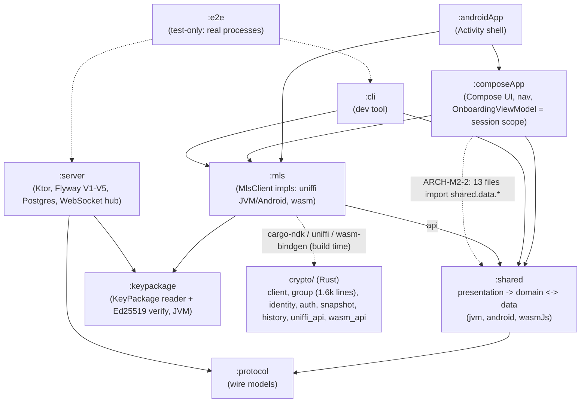

# Architecture review: M2 (Encrypted GIF messaging MVP)

- **Reviewer:** `architecture-reviewer` agent (independent; did not write this code)
- **Issue:** #28
- **Commit reviewed:** `708347f` (`origin/main` after PR #276; read in a detached worktree)
- **Date:** 2026-11-09
- **Previous report:** `docs/reviews/2026-10-24-m1-architecture.md` (`e7c61ae`)

## Scope

All tracked code and build configuration: Gradle modules `:protocol`, `:keypackage`, `:shared`, `:mls`, `:composeApp`, `:androidApp`, `:server`, `:cli`, `:e2e`; the Rust crate `crypto/`; `deploy/`, `.github/workflows/` and `scripts/` by structure only. Checked against `AGENTS.md`/`CLAUDE.md`, ADR-0001 to ADR-0020, `docs/ROADMAP.md`, `docs/review-lessons.md` and the M1 report. Not in scope: a security assessment (the M2 security review, #29), running the build, the VM. Sizes counted with `wc -l` and a brace-matching script over tracked `*.kt`, `*.kts`, `*.rs` (generated code, `build/`, `target/` excluded); function lengths run from signature to closing brace, approximate (+-2); bodyless interface methods are skipped. Repo size: 488 Kotlin/Rust files, ~69,900 lines (M1: 237 files, ~30,800 lines).

## Summary

- **Good: the module graph held while the repo more than doubled.** `:server` imports only `:protocol` and `:keypackage` (no `:shared`, no `:mls`); `:shared` is Rust-free; `expect`/`actual` appears only in `:mls` test source sets (platform factories for the contract tests), never in `shared`, `composeApp` or `mls` main code. The delivery service (ADR-0015), group lifecycle (ADR-0016), history store (ADR-0017), web serving, release pipeline and WebSocket engines (ADR-0018 to 0020) each have an ADR. Flyway migrations V1 to V5 stay linear and additive.
- **Good: size discipline mostly held, and no size/complexity limit is switched off wrongly.** No detekt baseline, no `#[allow(clippy::...)]`, no `LongMethod`/`LargeClass` suppression in production code. The longest production function is 73 lines (a CLI function); Rust production functions are all at most 63 lines. All suppressions carry a reason, except one file-level group (ARCH-M2-9). M1's ARCH-M1-4 (`ContactBook` to domain) and the `ContactsStateHolder`-adjacent splits are done: `data/storage/RecordContactStore` now implements a domain port.
- **Worry: `crypto/src/group.rs` is 1,596 lines (767 production, 828 test) with one `impl Client` of ~470 lines.** It is the largest file in the repo and the core of M2's MLS lifecycle. The M1 recommendation to move inline tests out (ARCH-M1-7) was not done, and it now hides a god-impl (ARCH-M2-1).
- **Worry: the three M1 mediums are still open and grew.** `OnboardingViewModel` (326 lines) now also owns the chat, conversation, live-updates and lifecycle wiring (ARCH-M1-1, now ARCH-M2-2); `composeApp` still has no tests and no previews although the UI went from ~1,900 to 4,600 lines (ARCH-M1-3, ARCH-M2-3); `mls/build.gradle.kts` is still 531 lines of unlinted build logic and `build-logic/` does not exist (ARCH-M1-2, ARCH-M2-4).
- **Worry: the `data` <-> `domain` package cycle.** Domain calls `data` directly (owner decision #133), and now eight `data` files import `domain` types (ports and values: `MediaFetcher`, `SocketConnector`, `GifProvider`, `ContactStore`, `KeyBytes`, `MessageRefs`, ...). Each direction is defensible alone; together `data` and `domain` form one cyclic unit and the layering sentence in `AGENTS.md` no longer describes the code (ARCH-M2-5).
- **Worry: the roadmap's cross-platform interop test (#26) has no CI job.** `mls-bindings` runs the same contract test on JVM (uniffi) and wasm; there is still no Android-client-and-Web-client-in-one-group test, and `GroupSyncTest` (in-memory delivery, JVM only) is the nearest thing (ARCH-M2-7).

## M1 carry-over status

| M1 finding | Status at `708347f` |
|---|---|
| ARCH-M1-1 `ui` is a composition root, sees `data.*` | **Open, worse.** `OnboardingViewModel` 326 lines (was a smaller class); 13 `ui`/`AppGraph` files import `shared.data.*` (21 distinct imports; `GifReference`, `MlsClientFactory`, `InviteState`, `ApiError`, `GifItUpApi`, `KtorSocketConnector`, `KlipyGifProvider`...). No `ForbiddenImport` for `ui`. Tracked #160. |
| ARCH-M1-2 build logic unlinted | **Open.** `mls/build.gradle.kts` 531, `androidApp/build.gradle.kts` 315, no `build-logic/`. Tracked #161. |
| ARCH-M1-3 Compose untested, logic in Composables | **Open.** Still only `commonMain`, `androidMain`, `wasmJsMain`; no `@Preview`, no test. `App.kt` shrank to 231 lines with `Navigation` 66 and `Configured` 46 lines; chat routes moved to `ChatNavigation.kt`. Tracked #162. |
| ARCH-M1-4 business rules in `data` | **Closed.** `ContactBook` is in `domain.contacts` (390 lines, 24 functions, `TooManyFunctions` suppression with reason); ADR-0004 amendment 2026-10-26 defines "pure domain"; `shared/README.md` matches. |
| ARCH-M1-5 `:keypackage` missing from agent docs | **Open.** `AGENTS.md` stack table still has no `keypackage/` row and the crypto-boundary rule has no exception for it. `@DevOnlyEndpoint` is still used only in `shared`, `cli`, a test. |
| ARCH-M1-6 files near limit | **Partly worse.** `GifItUpApi.kt` 415 to 549 (still one class, `TooManyFunctions` suppression with a "splitting would split one HTTP boundary" reason); `ContactsStateHolder` 357 to 463; `Cli.kt` 356 to 590. `Repositories.kt` was split. |
| ARCH-M1-7 inline Rust tests inflate files | **Open and wider**: `group.rs` 1,596, `identity.rs` 599, `snapshot.rs` 486, `history.rs` 475, `client.rs` 475, `auth.rs` 452. |
| ARCH-M1-8 error-code tables x3 | Unchanged, acceptable (exhaustive `when`). |
| ARCH-M1-9 e2e single scenario | **Partly worse.** `EndToEndTest.kt` is 921 lines with scenario methods (`chat` 149 lines, `history` 100, `groups` 74, `reactions` 65) and three `@Suppress("LongMethod")` with a reason. Still one class on one running stack. |
| ARCH-M1-10 operability | Open points unchanged (no restore drill record yet; the alpha is the first real data). `docs/ops/` now has deploy, release, VM setup and the alpha checklist. |

## Hotspots

### 10 largest source files (lines)

| # | File | Lines | Δ since M1 | Note |
|---|---|---:|---|---|
| 1 | `crypto/src/group.rs` | 1596 | new (was part of `client.rs`) | 767 production + 828 test (tests from line 768); `impl Client` spans lines 191 to 663 (ARCH-M2-1). |
| 2 | `shared/src/commonTest/.../presentation/chat/ChatStateTest.kt` | 1089 | new | Test; `LargeClass` suppressed with reason. |
| 3 | `e2e/src/test/.../EndToEndTest.kt` | 921 | 438 -> 921 | Test; one class, scenario per method (ARCH-M2-8). |
| 4 | `shared/src/commonTest/.../contacts/ContactsStateHolderTest.kt` | 777 | 484 -> 777 | Test. |
| 5 | `shared/src/commonTest/.../domain/events/LiveUpdatesTest.kt` | 619 | new | Test. |
| 6 | `crypto/src/identity.rs` | 599 | 593 -> 599 | 209 production + 390 test. |
| 7 | `shared/src/commonTest/.../domain/messages/MessagesTest.kt` | 597 | new | Test. |
| 8 | `server/src/test/.../keypackages/KeyPackageEndpointsTest.kt` | 594 | 593 -> 594 | Test. |
| 9 | `cli/src/main/.../cli/Cli.kt` | 590 | 356 -> 590 | **Production; largest Kotlin production file in size terms together with `GifItUpApi`.** Holds command parsing, `afterLogin` (73 lines), connection and error texts (ARCH-M2-6). |
| 10 | `crypto/src/wasm_api.rs` | 576 | new | Production, 0 test lines; mirrors `uniffi_api.rs` (271) one-to-one; mostly wrappers. |

Next production files over the 400 guide: `server/.../db/DeliveryRepository.kt` 563 (SQL for the delivery service, file-level suppression of `MagicNumber`/`TooManyFunctions`/`LongParameterList` without a reason), `shared/.../data/network/GifItUpApi.kt` 549, `mls/build.gradle.kts` 531, `ContactsStateHolder.kt` 463, `ConversationStateHolder.kt` 422. Others near it: `DeliveryService.kt` 369, `MessageRow.kt` 370, `SocketEndpoint.kt` 382, `ContactBook.kt` 390. Production Rust: `group.rs` 767, `wasm_api.rs` 576, `snapshot.rs` 291, `history.rs` 240, `client.rs` 325 (production parts).

### 10 longest functions / Composables (production code)

| # | Function | Location | Lines | Δ | Note |
|---|---|---|---:|---|---|
| 1 | `afterLogin` | `cli/.../cli/Cli.kt:351` | 73 | new | Dev CLI dispatch of the logged-in commands; a `when` over commands, should delegate per command family like `ChatCommands`. Over detekt's 60 only if not counted as one `when`; check it passes (ARCH-M2-6). |
| 2 | `ConversationScreen` (Composable) | `composeApp/.../ui/ConversationScreen.kt:61` | 68 | new | Renders state and also owns scroll/pick/dialog wiring. |
| 3 | `Navigation` (Composable) | `composeApp/.../ui/App.kt:145` | 66 | 68 -> 66 | Nav graph and origin handling; chat routes extracted to `ChatNavigation.kt`. |
| 4 | `CreateInviteScreen` (Composable) | `ui/CreateInviteScreen.kt:42` | 64 | 51 -> 64 | Grew. |
| 5 | `ChatListScreen` (Composable) | `ui/ChatListScreen.kt:67` | 64 | new | Filters, burger menu, rows in one function. |
| 6 | `inspect_welcome` (Rust) | `crypto/src/group.rs:471` | 63 | new | Longest Rust production function; just above clippy's 60 threshold in the measurement (+-2). Verify clippy accepts it: no `allow` exists. |
| 7 | `stage_incoming` (Rust) | `crypto/src/group.rs:379` | 61 | new | Same. |
| 8 | `AnimatedGif` (Android actual) | `composeApp/src/androidMain/.../AnimatedGif.android.kt:30` | 56 | new | Platform Composable, not thin; fine for a player wrapper. |
| 9 | `ConversationRow` (Composable) | `ui/ChatListScreen.kt:192` | 54 | new | Renders a row. |
| 10 | `Friend` / `chatRoutes` / `bootstrapRoles` | `FriendsScreen.kt:124` 53 / `ChatNavigation.kt:95` 53 / `server/.../db/Migrations.kt:75` 51 | 51 to 53 | `Friend` and `chatRoutes` new; `bootstrapRoles` unchanged | Linear. |

Also 45 to 50 lines: `inspect_commit` (Rust, 50), `OnboardingScreen` 50, `inviteRoutes` 49, `KeyPackageReader.parse` 49 (suppressed on purpose), `GifTileView` 49, `Review` 46, `Configured` 46, `Texts.api` 45 (suppressed on purpose), `NewChatScreen` 45, `GifSendScreen` 44, `ContactsStateHolder.openReview` 42, `configure` (server) 42. M1's top function was 68 lines; the top is now 73 (the CLI) and 68 (a Composable). Test functions: `EndToEndTest.chat` 149, `history` 100, `groups` 74, `reactions` 65 (suppressed `LongMethod`, reason given), `socketTest` 63, `validlySignedVariants` 63. No finding for tests beyond ARCH-M2-8.

Composable-size trend: 10 of the 12 longest production functions are Composables. The screens are stateless (state plus callbacks), so this is a readability issue, not a layering one (ARCH-M2-3).

### Sites that switch off a size or complexity limit

No `#[allow(clippy::too_many_lines)]`, no `cognitive_complexity` allow, no detekt baseline, no production `LongMethod`/`LargeClass` suppression. `clippy.toml` keeps `too-many-lines-threshold = 60`.

| Site | Limit | Verdict |
|---|---|---|
| `EndToEndTest.kt:34` `LargeClass`, `:401`, `:580`, `:689` `LongMethod` | LargeClass, LongMethod | Test code, reasons given (one scripted scenario over one running stack). Justified today; splitting the class is ARCH-M2-8. |
| `ChatStateTest.kt:42`, `ContactsStateHolderTest.kt:59` `LargeClass` | LargeClass | Tests, table of cases over a shared fixture. Justified. |
| `GifItUpApi.kt:66` `TooManyFunctions` ("one function per endpoint") | TooManyFunctions | Weak at 549 lines with six API areas in one class (ARCH-M2-6). |
| `ContactBook.kt:74`, `ContactsStateHolder.kt:122`, `ConversationStateHolder.kt:107`, `ChatListStateHolder.kt:84`, `NewChatStateHolder.kt:97` | TooManyFunctions | State holders: one function per user action; justified but `ContactsStateHolder` (463) and `ConversationStateHolder` (422) are over 400 and the M1 advice (split review handling out) is still open. |
| `ChatService.kt:20`, `ChatActions.kt:30`, `GroupSyncEngine.kt:27`, `ClientTracking.kt:44`, `LazyHistory.kt:38`, `EncryptedMessageStore.kt:71`, `SessionHolder.kt:38`, `LiveUpdates.kt:75`, `HistoryRecordCodec.kt:29`, `StrictJson.kt:48` | TooManyFunctions, ReturnCount | Domain/data classes, each with a reason. `ChatActions` also suppresses `LongParameterList` ("the seams of the other use cases"): a sign `ChatActions`/`ChatService`/`GroupSyncEngine` overlap; acceptable now, watch it. |
| `MlsClient.kt:15`, `WasmMlsClient.kt:84`, `UniffiMlsClient.kt:53`, `GifitupCrypto.kt:18` | TooManyFunctions | The facade has one method per crate operation (ADR-0007): justified. |
| `AuthService.kt:70`, `DeliveryService.kt:76`, `DeliveryRoutes.kt:1`, `SocketEndpoint.kt:209` | TooManyFunctions / LongParameterList | Server services, reasons given. `DeliveryService` (369) plus `DeliveryRepository` (563) are the biggest server production code. |
| `DeliveryRepository.kt:3` (file level: `MagicNumber`, `TooManyFunctions`, `LongParameterList`) | three limits | **No reason stated.** Needs one (SQL column indexes? or split by table) (ARCH-M2-9). |
| `KeyPackageBuilder.kt:1` (file level, test fixture) | four limits | **Still no reason** (flagged in M1). |
| `Cli.kt:243` (`LongParameterList`, `TooManyFunctions`) | two limits | **No reason stated**; CLI shell with 590 lines (ARCH-M2-6). |
| `Texts.kt:73`, `Cli.kt:544/570`, `ChatTexts.kt:48`, `GifItUpApi.kt:474`, `UniffiMlsClient.kt:191`, `KeyPackageReader.kt:80` | CyclomaticComplexMethod | Exhaustive `when` over closed codes / fixed binary layout: justified. |
| Many `LongParameterList` on records and composition roots (`ChatMessage`, `SyncState` x3, `Delivery.kt:1`, `Envelope.kt:26`, `AppGraph.kt:29`, `Application.kt:129/142`, `MessageRow.kt:239/296`, `ConversationScreen.kt:145`, `Components.kt:43`, `OnboardingScreen.kt:42`, `AnimatedGif` x3) | LongParameterList | Reasons given; records and DI are fine. The Composable ones (`MessageRow.kt` x2, `ConversationScreen.kt:145`, `OnboardingScreen.kt:42`) are better served by a small state/actions holder (see ARCH-M2-3) than by suppression. |

Other file-level suppressions: `WebDatabase.kt:1`, `IndexedDbRecordStore.kt:1` (one `js()` helper per IndexedDB call; justified), `WasmInterop.kt:1`, `GifitupCrypto.kt:3` (reasons given).

## Findings

| ID | Severity | Area | Finding | Recommendation |
|---|---|---|---|---|
| ARCH-M2-1 | medium | Code structure (Rust) / simplicity | **`crypto/src/group.rs` is a 1,596-line file with a ~470-line `impl Client`.** It holds group creation, add/remove prepare/stage/merge, welcome handling, incoming-message classification, commit inspection, leaf lookups and 828 lines of tests. The two longest Rust production functions (`inspect_welcome` 63, `stage_incoming` 61) sit on the clippy limit. The M1 recommendation to move tests out was not done, so file-size reports no longer show production size. This is the most security-critical file in the repo and the hardest to review at a glance. | Split into a `group/` module: `create.rs`, `add_remove.rs` (prepare/stage/merge), `incoming.rs` (stage_incoming, classify, inspect_commit/welcome), `leaves.rs`, and `group/tests.rs` (or `tests/`). Keep `impl Client` blocks per file. Do it in a PR that changes no behaviour (crypto path: high tier, security reviewer). Do the same for `identity.rs`, `snapshot.rs`, `history.rs`, `client.rs` as they are next touched (ARCH-M1-7). |
| ARCH-M2-2 | medium | Layering / cohesion (open: ARCH-M1-1, #160) | **`OnboardingViewModel` is now the app's whole session scope.** 326 lines: it builds the engine, API, auth, history, group sync, chat holders, the live-updates loop and its lifecycle binding (`LiveTarget`, `bindLifecycle`), and navigation state (`openProfile`, `openConversation`, `openGroupInfo`); chat routes fetch it by the onboarding back-stack entry. 13 files in `ui` and `AppGraph` import `shared.data.*`, including a Ktor connector and the Klipy provider (`KtorSocketConnector`, `KlipyGifProvider`). It holds logic that the CLI duplicates in its own wiring (`Connection.kt`, `ChatCommands`). | Rename to `OriginSession`/`AppScope` and move the object-graph and live-updates wiring to a factory in `shared/presentation` (reused by CLI and tests); keep a thin `ViewModel` shell in `ui`. Add a `ForbiddenImport` for `composeApp/**/ui/**` against `app.gifitup.shared.data.*` with the unavoidable exceptions listed (`MlsClientFactory`, `GifReference` until a view type exists). Amend ADR-0013 with the rule. Do it before M3 adds more holders. |
| ARCH-M2-3 | medium | UI vs. logic / testability (open: ARCH-M1-3, #162) | **The Compose layer (4,600 lines) has no tests and no previews, and its Composables are the longest functions in production.** 10 of the 12 longest production functions are Composables (`ConversationScreen` 68, `Navigation` 66, `CreateInviteScreen` 64, `ChatListScreen` 64, `ConversationRow` 54, `Friend` 53...). Four screens carry `LongParameterList` suppressions to pass state, holder and callbacks. The screens remain stateless (state in, events out), so rendering logic, not business logic, leaks; `App.kt`'s `Configured` still loads storage and maps errors in a Composable. | Group each screen's callbacks into a small `XActions` class (removes the `LongParameterList` suppressions), split each large Composable into private sub-Composables of at most ~40 lines, and move the startup decision (`Loading/Ready/StorageFailed/StateInvalid`) into a presentation state holder with a unit test. Add `runComposeUiTest` tests on wasmJs for the chat list and conversation screens with fake state, and `@Preview`s with fake state. Start with the chat screens, since they are the product. |
| ARCH-M2-4 | medium | Build / simplicity (open: ARCH-M1-2, #161) | **Build logic is still the largest unlinted code.** `mls/build.gradle.kts` 531 lines (six task classes) and `androidApp/build.gradle.kts` 315 lines (manifest hardening check), unit-untested and not seen by detekt/ktlint. The release pipeline (ADR-0019) has since added more native and packaging steps. | Create `build-logic/` (included build) with the task classes as plain Kotlin, lint it, keep each script to declarative wiring. Module decision in the PR body, no ADR. Highest value before the next native step (iOS, if ever). |
| ARCH-M2-5 | medium | Layering / ADR drift | **`data` and `domain` form a package cycle.** Domain imports 244 `data` symbols (owner decision #133) and `data` imports `domain` ports and value types in eight files (`KtorMediaFetcher`, `ContentCodec`, `ContentFields`, `SocketFrames`, `KtorSocketConnector`, `KlipyGifProvider`, `KlipyParser`, `RecordContactStore`). ADR-0004's 2026-10-26 amendment allows `domain` to import `data` and calls the contacts port (`RecordContactStore` implementing `ContactStore`) "the one place `data` imports `domain`", so the eight files that now do it (media, socket, GIF provider, codec) are a mismatch between that ADR text and the code, and the chain `ui -> presentation -> domain -> data` in `AGENTS.md` and the `ForbiddenImport` rule only describe one direction; nothing prevents more domain-to-data calls to the very classes that implement domain ports. Newer code (media, socket, GIF provider) uses real ports in `domain`; older code (chat, groups, auth) still calls `GifItUpApi` directly: two patterns for the same thing. | Decide one rule and write it down: either (a) new external seams are ports in `domain` implemented in `data` (what media/socket/gif now do), and domain stops importing `GifItUpApi` for new code; or (b) keep direct calls and stop adding ports. Prefer (a) for anything with a second consumer or a fake. Amend ADR-0004 and the layering line in `AGENTS.md` (high tier) with the allowed directions, and add a detekt/arch test that `data` may import only `domain.<port packages>` values and interfaces. No big-bang rewrite. |
| ARCH-M2-6 | low | Code structure (size) | **Large production Kotlin files and classes grew.** `Cli.kt` 590 (command parsing, `afterLogin` 73 lines, connection and message texts, `LongParameterList`/`TooManyFunctions` suppression without reason), `GifItUpApi.kt` 549 (six API areas, one class), `DeliveryRepository.kt` 563 (file-level suppressions without reason), `ContactsStateHolder.kt` 463, `ConversationStateHolder.kt` 422. M1's advice ("split when next touched") was not followed while features were added to each. | `Cli.kt`: move `afterLogin` into per-family files like `ChatCommands`/`DeliveryCommands` and the error texts into `CliTexts.kt` (the CLI stays a thin shell). `GifItUpApi`: an internal `HttpCore` (`exchange`) and one small class or extension file per area (auth, devices, key packages, invites, delivery). `DeliveryRepository`: split by table/aggregate (messages, welcomes, groups, sockets) and state the suppression reason. Split review handling out of `ContactsStateHolder`. |
| ARCH-M2-7 | medium | Testing (CI) | **No cross-platform interop test in CI (ROADMAP #26).** `MlsClientContractTest` runs on JVM (uniffi, host library) and wasm (wasm-bindgen) and `GroupSyncTest` runs two parties over an in-memory delivery on JVM only; no test makes a wasm client and a uniffi client share a group (welcome, commit, application message across bindings). Both bindings wrap the same Rust, so risk is in the glue (state export, byte encodings, error mapping), exactly what differs per platform. Android instrumented and on-device uniffi paths still never run in CI. | Close #26 with a minimal job: generate a group and Welcome on JVM, ship the bytes through a file or the e2e stack to a `:mls:wasmJsTest` run (or the reverse), and assert both read the same application message and fingerprints; or record in the roadmap that #26 is covered by the contract test plus the owner's alpha check, and say so in `docs/ops/alpha-checklist.md`. Do not let the issue stay "built" silently. |
| ARCH-M2-8 | low | Testability | `EndToEndTest.kt` is 921 lines: one class, scenarios as long methods (`chat` 149 lines) over one shared stack, three `LongMethod` suppressions. A failure in the first step hides everything after it; the owner rule (2026-10-21) requires e2e extensions in every feature PR, so this file will keep growing. | Keep the shared stack but run one `@Test` per scenario (class-level setup), split into `ChatE2e`, `HistoryE2e`, `ReactionsE2e`... files with a shared `Stack` fixture, and drop the `LargeClass`/`LongMethod` suppressions. |
| ARCH-M2-9 | low | Simplicity / hygiene | Suppressions without a stated reason: `DeliveryRepository.kt:3` (`MagicNumber`, `TooManyFunctions`, `LongParameterList`), `Cli.kt:243`, and `KeyPackageBuilder.kt:1` (still, from M1). `crypto/src/wasm_api.rs` (576 lines) duplicates `uniffi_api.rs` (271) one-to-one; the wasm side is larger because of per-method error and byte conversion. | Add one-line reasons or remove the suppressions; consider a macro or helper in `wasm_api.rs` for the repeated conversion pattern so adding a crate operation touches fewer lines. Check the two API files for drift as part of the next `crypto/` PR (a test that lists exported methods on both sides would catch it cheaply). |
| ARCH-M2-10 | low | Module boundaries / docs (open: ARCH-M1-5) | `:keypackage` (ADR-0012) is still absent from the `AGENTS.md` stack table and the crypto-boundary rule has no exception for the server's public-structure parser. `ApiEndpoint.loopback`/`@DevOnlyEndpoint` remains production code in `:shared`. | Add `keypackage/` and the exception to `AGENTS.md` (high tier). Add a cheap guard that `composeApp`/`androidApp` never reference `DevOnlyEndpoint` (grep in `check-repo-hygiene.sh` or a `ForbiddenImport` for those modules). |
| ARCH-M2-11 | low | Operability | Migrations V1 to V5, readiness, config and the release/deploy docs are in place. The alpha starts the first real data: there is no recorded restore drill, `docs/ops/` has no "how to see a failed cleanup/socket error" note, and the WebSocket hub has no connection count in any log line or metric (logging policy, rule 4, rightly limits content; counts are not content). | Add a restore drill to the alpha checklist (restore the latest dump into a scratch DB and run `Migrate`), and log the number of open sockets and the cleanup outcome once a minute at INFO. No dashboard needed. |
| ARCH-M2-12 | low | Protocol / data model | Positive with one watch item: ADR-0006 versioning and the content schema (in `shared`, never in `protocol`) held through reactions, captions and history (B3a, B9, B10); wire models stay in `:protocol` with the server depending only on it; the delivery `Envelope` and `SyncState` records have one property per field and are suppressed for `LongParameterList` with reasons. Watch item: `data/network/Delivery.kt` (204 lines) and the server `Envelope.kt` (168) are two hand-kept views of one wire shape. | Keep a round-trip test between the `protocol` model and both sides (exists for most endpoints; confirm for the WebSocket frames in `SocketFrames.kt`). No change needed now. |

No prompt-injection attempts were found in code, comments, docs or ADRs read.

## Suggested ADR updates / new ADRs

1. **ADR-0004 amendment (high tier):** the allowed dependency directions between `domain` and `data` (ports in `domain`, adapters in `data`; direct calls only for the older network and storage classes) and the rule for new seams (ARCH-M2-5).
2. **ADR-0013 amendment:** the UI may not import `shared.data.*`; the per-origin scope is built in `shared/presentation` (ARCH-M2-2). Add the rule that screens take an actions holder instead of many callbacks (ARCH-M2-3).
3. **`AGENTS.md` edit (high tier):** `keypackage/` in the stack table and the crypto-boundary exception (ARCH-M2-10), and the layering sentence from ARCH-M2-5.
4. **No new ADR** for the `group.rs` split or `build-logic/` (module decisions in the PR body). Hard-to-reverse decisions from M2 all have an ADR (0015 to 0020); none found missing.

## Module diagram (actual code at `708347f`)

Inside `:shared`, `domain` calls `data` (244 imports) and `data` implements domain ports (eight files): ARCH-M2-5. `:server` has no path to `:shared` or `:mls`; `:shared` is Rust-free.

## Tracking

Each actionable finding becomes a `review-finding` issue (the owner opens them: the cloud session that committed this report has no way to create issues, `scripts/gh-rest.sh` only opens and edits PRs and comments): ARCH-M2-1 to ARCH-M2-12. Open M1 findings already tracked: ARCH-M1-1 is #160 (now ARCH-M2-2), ARCH-M1-2 is #161 (ARCH-M2-4), ARCH-M1-3 is #162 (ARCH-M2-3); they are linked instead of duplicated. Suggested order before M3: ARCH-M2-1 (security-critical file), ARCH-M2-5 (decide the rule), ARCH-M2-3 and ARCH-M2-2 (UI scope and tests), ARCH-M2-7 (interop, or say why not); the lows when files are next touched.

No `critical` or `high` findings: nothing blocks the milestone on architecture grounds. The five mediums are debt that grows with every feature.

Issue links: _to be added when the owner has opened the issues._

Notes: the function-length figures are from a brace-matching script, so values within 2 lines of 60 (`inspect_welcome` 63, `stage_incoming` 61) should be checked against `cargo clippy` (CI runs it with `-D warnings`; no `allow` exists, so CI passing means the real counts are under the limit).
