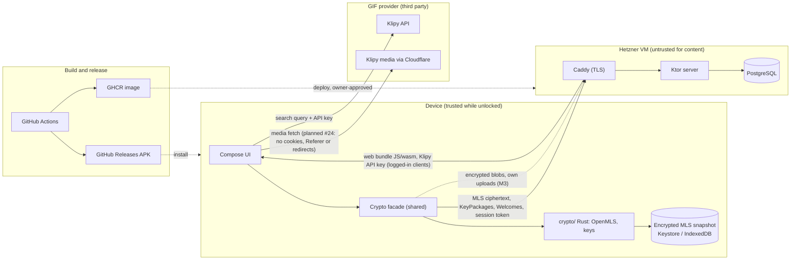

# Threat model (v1)

_This is a living document. Update it whenever a PR changes security assumptions; the security reviewer checks it each milestone. Report vulnerabilities as described in [`SECURITY.md`](../../SECURITY.md)._

## Assets
- GIF message content, meaning which GIF was sent in which chat.
- GIF search queries.
- Private keys (signature keys, MLS group secrets, local storage keys).
- Social graph: who talks to whom and in which groups.
- Account credentials and session tokens; invite codes.

## Data flow and trust boundaries
Everything outside the **device** box is untrusted for content. Dashed lines are planned (M3) or one-off.

What crosses each boundary:
- **Device → VM:** message content only as MLS ciphertext (application messages and handshakes as `PrivateMessage`). Never plaintext, GIF URLs, search terms or private keys. Alongside it, account and control data: credentials and session token, invite codes, username and device registration with public keys, KeyPackages and claims, Welcomes, the DS envelope (group ID, device list, epoch), inbox acks/read cursors, blob requests (M3) and push tokens (later). What this reveals is listed under *Known metadata visible to the server*.
- **VM → device:** relayed ciphertext, the web client code (see Accepted risks) and the Klipy API key. Each is untrusted: ciphertext is authenticated by MLS. Planned in #23: the key is checked for format and used only with the hard-coded provider host.
- **Device → GIF provider:** search terms and media fetches, directly from the client (ADR-0003). The provider sees the IP addresses.
- **Build → device/VM:** see the supply-chain row.

## Adversaries
| Adversary | Capabilities | In scope? |
|---|---|---|
| Curious or compromised **server / VM operator** | Reads the DB and traffic, can modify server code, can inject, drop, reorder or withhold messages | ✅ A **passive** server must not learn content or GIF identity. ⚠️ An **active** server can man-in-the-middle a first contact until key verification exists (see Accepted risks). Forged messages are detected by MLS; dropping, withholding and forking are *not* prevented (see Limitations). |
| **Network attacker** | Passive or active on the client↔server path | ✅ |
| **Malicious group member / friend** | Valid member who may misbehave | ✅ After removal they cannot read messages from later epochs. |
| **GIF provider** (Klipy, and Cloudflare in front of its CDN; ADR-0003) | Sees search queries and the sender's IP, and every recipient's IP and the GIF when they load it (Mode B′). Controls which bytes its CDN serves, including different bytes per recipient or hostile files aimed at image decoders. Can remove GIFs, shut down, or revoke our shared API key | ⚠️ Accepted leak (ADR-0003). Our server never sees GIF identity or searches. Recipients only fetch URLs on the provider's media hosts (strict allowlist), with no cookies, `Referer`, redirects or `customer_id`. Our own bounded scanner checks the file structure before any decoder runs, and decoding uses decoders that get security updates (see Assumptions); outdated Android phones get tap-to-load. A removed GIF shows a placeholder |
| **Stolen or unlocked device** | Full access to the app's local state | ⚠️ Partially. Built for Android (#16 PR C, ADR-0011; the Keystore part is checked by hand on a device, not in CI, and used from onboarding, #17): the snapshot key is stored only wrapped by an Android Keystore key (TEE, or StrongBox where available), so a copy of the app's files (backup, forensic file copy, another app through a platform bug) is useless. Not protected: code running as the app's uid (including `adb run-as` on a debuggable build, so release builds stay non-debuggable), a rooted or unlocked device that can call the Keystore, and memory, which holds the snapshot key while the app runs. Web: see *Limitations*, nothing against a copy of the profile |
| **Malicious group member** (active) | Sends envelope/Commit mismatches, spams commits | ⚠️ Can deny service to a group (stuck/forked). Recovery is a new group (ADR-0002). Cannot read groups it was never in. |
| **Crafted MLS input** (from a member or replayed by the server) | Malformed KeyPackages, Welcomes or messages that make OpenMLS or our wrapper panic or misbehave | ⚠️ In place (ADR-0007): errors mapped to closed codes with no detail; on Android/JVM every FFI call caught with `catch_unwind`, the panic payload dropped, a silent panic hook, calls serialized per client, and a client that panicked once refuses every later call, state export included; on the web every call into the module runs inside a JavaScript try/catch (Kotlin's own `catch` can't see a trap), so a trap marks the whole module dead on the call that caused it, and a Rust-side trap detector makes it refuse every later call that touches MLS state (classification unit-tested; a real Rust panic is tested on the JVM and as a real trap in headless Chrome through a test-only feature that release builds can't contain, ADR-0007; after a trap, the key's Rust copy and all MLS state stay in the dead module's memory until the page reloads); `overflow-checks` in release. Mutation tests of the KeyPackage, Welcome, message and snapshot parse paths (they mostly exercise the outer framing, since signatures and AEAD reject most mutations; the deeper parsers are #64's fuzzing) (a malformed value inside a *decrypted* snapshot still panics in OpenMLS's storage: only reachable by the key holder or our own bug; Android/JVM → `Poisoned`, web → trap; the restore guard breaks the reload loop: built in #16 with its counter in the web store (ADR-0011), live once onboarding (#17) restores through it). Planned: the page reload after a trap (#17); quarantine of a message that keeps failing, per-group state, never persisting after a panic in the sync engine (#22); coverage-guided fuzzing (#64). |
| **Local state rollback** (backup restore, crash, copied profile) | Restores an older MLS snapshot | ⚠️ In place: Android backup excluded; the snapshot is encrypted inside Rust and authenticated (#11, ADR-0007), which stops tampering but not rollback to an older valid snapshot. Web store built (#16 PR B, ADR-0011; used from onboarding, #17): atomic writes (one IndexedDB transaction, aborted as a whole if any entry fails) that ask for strict durability (`durability: "strict"` is a hint; a browser that ignores it may lose the last write in a crash, and this was only tested in Chromium), and no old snapshot in the app's logical store (physical copies on disk aren't erased, see *Limitations*). Android: one file in `noBackupFilesDir`, written to a temp file, synced, renamed over the old one, then the directory synced (#16 PR C; the file logic is tested on the JVM, the directory sync on Android by hand). Planned in #21, #22 and #24 (moved from #16, owner decision 2026-10-18): persist before send and before ack, and freshness anchored at the Delivery Service, because an epoch check alone misses a rollback within an epoch (spikes #3, #4; ADR-0002). Without this, a restore can reuse ratchet keys and nonces. |
| **Prompt injection against AI agents** | Anyone can write issues, PR comments, or content agents read (dependency docs, API responses) on this public repo | ⚠️ Only owner-authored text counts as instructions (CLAUDE.md rule 7). There is no separate bot identity (owner decision 2026-10-13), so the agent technically has the owner's merge and settings power; the guard is the hard rule in CLAUDE.md plus the deny list (see Accepted risks). |
| **Supply chain / build pipeline** | Compromised dependency, GitHub Action, GHCR image, deploy SSH key, APK signing key, or web bundle | ✅ Pinned actions, committed lockfiles (Gradle, Cargo, Yarn), secret scanning with push protection, CodeQL (`security-extended`; Actions, Kotlin, Rust; Rust dependencies fetched `--locked`, then extracted offline; `wasm_api.rs` gets syntax-only analysis because it compiles only for wasm32; the Kotlin build includes `:mls`, which compiles the crate offline), a prebuilt `wasm-bindgen-cli` in the `Gradle check` job, which compiles `crypto/` (version and SHA-256 pinned in `ci.yml`), a CI repo-hygiene check (`scripts/check-repo-hygiene.sh`), shellcheck on every tracked `*.sh` (including `deploy.sh`) and actionlint on every workflow in CI (pinned, checksum-verified binaries; #48; blocks merges only once the owner adds it to the ruleset's required checks), SHA-256 dependency verification for every Gradle artifact (trust-on-first-use, no PGP yet), repositories restricted per group, Dependabot alerts, least-privilege workflow tokens, signing key held by the owner only. **Server deploys (#7):** the release build runs without any Actions or Gradle build cache. Registry credentials live in a separate job from Gradle. The image gets build provenance, and the deploy job verifies it (built by `deploy.yml` from `main` at that commit) before an owner-approved `production` deploy (admin bypass off). The VM runs it by digest, and CI's SSH key can only run `deploy.sh`, which accepts nothing but a validated commit/digest pair. Residual: approving a deploy runs that commit's compose and script as root-equivalent on the shared VM, and a compromised `main` deploys like any merge. The VM itself doesn't verify provenance: whoever holds the CI SSH key can deploy any image in the package, or an older commit's `deploy.sh`. The workflow's `main` guards live in the workflow file, so a dispatch on a branch can push an unreviewed image to the package; provenance verification and the environment's main-only rule still keep it from being deployed through CI. Base and Postgres images are digest-pinned and tracked by Dependabot. ⚠️ Dependabot's *Gradle* security PRs don't pass CI on their own: someone has to regenerate locks and checksums (docs/dependencies.md), so a Gradle security fix lands only as fast as that happens. |
| Global passive adversary / traffic analysis | | ❌ Out of scope for now |

## Security goals
1. Confidentiality and authenticity of message content against the network and a passive server. Against an active server this holds only for contacts whose keys were verified, or who were first contacted while the server was honest.
2. Forward secrecy and post-compromise security (recovery after a key compromise) as provided by MLS, with regular self-updates. Removed members lose access to later epochs. **Caveats:** FS does not cover the locally stored message history or the blob keys kept in it. Encrypted blobs (own uploads, M3) stay on the server until their TTL. OpenMLS `max_past_epochs` (kept small) retains old epoch secrets for late messages.
3. The server learns neither GIF identity nor search terms (ADR-0003).
4. Only people holding a member's invite link can register; invites are single-use and expire (ADR-0010, in place since #13). This keeps outsiders out, not the server: an active server can register anyone (ADR-0010, "What each control protects").
5. Users can detect key changes (M3: safety numbers).

## Limitations (not prevented)
- **The server reads KeyPackages at upload (ADR-0012)** with its own strict Kotlin reader of untrusted bytes: bounded (2 KiB, 50 per request, flat, canonical lengths, whole input consumed), signature-checked, and tested against the real crate. It does not validate the deeper capabilities and extension contents, so a member can still upload bound, correctly signed KeyPackages with hostile inner bytes. That harms only claimers of that member's packages, and every claimer's `inspect_key_package` must survive it (row on crafted MLS input; fuzzing #64; on the web a trap reloads the page). A claim is consume-on-read: a lost response loses that KeyPackage. `lowWaterMark` comes from the server, so clients clamp it to 1..200. Failed uploads spend the upload bucket.
- **An active server can hand each user a different GIF provider key** (spike #5). If the provider shows per-key analytics (not verified for Klipy), the operator could tie search terms to individual users. That breaks goal 3 against an *active* server. Possible later mitigation: group members compare a hash of the key over MLS.
- **GIF media isn't bound to the message (Mode B′):** MLS authenticates the media URL, not the bytes. The GIF provider/CDN can serve different content over time or per recipient.
- **A malicious member could learn when recipients load a GIF** if the provider offers uploaders view analytics (not verified for Klipy) and the member uploads a GIF there.
- The server can **drop, delay, withhold or reorder** messages. It can also show different members different views of a group (**forking**, e.g. by delivering conflicting commits to different members). MLS makes forged messages impossible, but it does not guarantee delivery or consistency. A later partial mitigation: clients compare the epoch authenticator or transcript hash, out of band or in-band.

- **Device authentication (ADR-0009):** a device logs in by signing the server's challenge with its MLS signature key (crate function `sign_auth`, since #12 PR C; endpoints since #12 PR D2; registration needs an invite, ADR-0010).
  - **Signatures can't be repurposed:** an auth signature can't be replayed against another server (it covers the client's own configured origin, and the server verifies against its own configured origin, never one from the request), can't be used for the other purpose, and is never valid as an MLS signature (own label). The crate builds the signed bytes itself and exports no way to sign arbitrary bytes.
  - **Not prevented, relay after TLS:** a peer on the shared `proxy` network that takes the server's alias (Accepted risks, "Shared VM") can relay the real challenge and keep the session token: a valid token for up to 24 h. There is no channel binding.
  - **Not prevented, key compromise:** auth key = MLS key, so a stolen, unlocked device gives both, and MLS post-compromise security doesn't cover a stolen signature key. There is no key rotation and no self-service device removal yet; until then the owner deletes a device by hand (`docs/ops/deploy.md`).
  - **Not a secret:** device ids will be visible to group members (#22); login relies on the signature, never on the id being unknown.
- **Dev CLI test keys (#79 PR B1/B2):** the CLI keeps its combined auth/MLS signature key and snapshot key in a plain state dir. On POSIX file systems the files are created `rw-------`, and so is the dir if the CLI creates it; an existing dir keeps its permissions. On Windows nothing is set: the files inherit the folder's ACL, so the state dir belongs under the user's profile (#102 SEC-17). A copy of that dir is the account until the account is deleted.
  - **The real-account guard is against accidents, not an adversary.** It is `TestAccountGuard` in `:shared`, keyed on the signed origin, not on the transport. Test origins (canonical `https://` origins on `*.invalid`, `*.test` or `localhost`; anything non-canonical is not one) are always allowed. Any other origin needs `--remote-test-account` and a `cli_` username; the CLI checks it before every command that talks to a server, with the stored username for `login`/`devices`. Anyone can build a CLI without it, and it can't tell a test account from a real one beyond the prefix.
  - **A remote test account is a full member while it exists:** it can create invites, and later it can be found as a contact and added to groups. The smoke test in `docs/ops/deploy.md` ends with `admin delete-account cli_smoke` on the VM and deleting the state dir; the invite is read with `read -rs` and piped in, so it's neither echoed nor in the shell history.
  - **Kept out of output:** invite codes come from stdin only (never argv or the environment), read as a plain line: typed input is echoed, so on a shared screen pipe it in (#103 CR-3, SEC-14). Tokens live in memory only, and each command logs out; a failed logout prints a warning and the token expires on its own. Errors are fixed texts, with only a class name for anything unexpected. The runtime classpath has no slf4j provider except `slf4j-nop` (an allowlist in the hygiene check, #103 CR-4, SEC-15); `java.util.logging` keeps the JDK default (INFO and up to stderr). The end-to-end test (`e2e/`, #79 PR C) asserts that the invite codes and database passwords (each in full and by its random part, so an escaped copy is caught) appear in none of the captured CLI, server, Migrate, Admin (all of its output except the line that is the invite link) or Postgres output, and that no process output holds a session-token-shaped string (43 base64url characters; the test never sees the real tokens, #104 SEC-1..SEC-3); it starts every process with an empty environment plus what it needs, and on a failure prints that output only with known secrets and code- or token-shaped strings redacted (round-0 SEC-6, SEC-9). Its server listens on `127.0.0.1` only (`HOST`); its Postgres runs without Ryuk, which the shared fixture enforces, and its port is published on all interfaces for the run (Testcontainers' default, test data and random passwords only). The test deletes its work dir (raw output, secret files, the test keys) when it ends (round-0 SEC-4, SEC-11).
  - **The `ApiEndpoint.loopback` seam** (plain http to `127.0.0.1`/`[::1]` with a separate origin) is opt-in (`@DevOnlyEndpoint`, a compile error otherwise). Only `ApiEndpoint.kt`, `:shared`'s tests, `cli/` and `e2e/` may mention it, and no build file except `settings.gradle.kts` and `e2e/build.gradle.kts` (which runs the installed CLI; nothing may depend on `:e2e`) may refer to `:cli`/`:e2e` or their dirs (both hygiene checks; text checks that fail closed, #102 SEC-13). CI also scans the shipped APKs (dex) and the web bundle (`.wasm` and the rest of the dist) for the CLI's usage text and package name, with the app's own package prefix as a control in the same form (#102 SEC-13, #103 SEC-17/18).
- **A leaked invite link** (posted in the wrong chat, forwarded, or on a stolen phone) gives an outsider an account, and that account can invite more people (5 open at a time). The inviter can see in their invite list who joined; the owner contains it with the admin command `delete-account --with-invitees` (ADR-0010).
- **A deleted username can be registered again** by anyone holding an invite, and friends get no signal that it's a different person (a new account has new keys, so key-change detection, goal 5, is the signal once it exists). Deleting an account also doesn't remove it from MLS groups it was in; members have to remove it (tracked in #18 and #22).
- **Displayed message times come from the server.** Message content carries no timestamp (ADR-0006), so the untrusted server can back-date messages as well as reorder them.
- **Message references (ADR-0006 B9, Planned #22/#24) identify a delivered ciphertext, not an authored message.** Any group member can re-encrypt another member's message within the same epoch (all members can derive every sender's ratchet keys, and the MLS signature doesn't cover the generation), so recipients see a second copy, attributed to that sender, under a different reference; reactions can split across the copies. After a local state rollback a replayed message can arrive again under the same reference (the store keeps the first). The server can compute every reference from the ciphertext it stores, which is harmless only because references never leave the encrypted content (B9).
- **Annotations (ADR-0006 B10, e.g. reactions) are best effort:** older clients drop them silently, and because the server can reorder or withhold messages, two members can end up with different annotation state. Annotations are therefore never used for anything whose loss would change what a message means (edit, delete, expiry).

- **Web client at rest (spike #4, corrected by SEC-1 on #37):** MLS state in the browser (identity key, all group secrets) is a snapshot in IndexedDB.
  - **A non-extractable WebCrypto key does *not* protect it against offline access to the profile:** Chromium and Firefox store the key's raw bytes on disk next to the ciphertext. Non-extractability is only enforced through the JS API; Safari/WebKit is the exception and wraps stored keys with the Keychain.
  - **Without a user passphrase**, anyone with a copy of the browser profile (backup, stolen laptop, malware) can decrypt all of it.
  - **Script running in our origin** (XSS, a compromised or maliciously served bundle) can use any key and read wasm/JS memory, passphrase or not.
  - **Old copies remain on disk (ADR-0011):** the app keeps one record and replaces it in place, but Chromium's LevelDB files and Firefox's SQLite WAL and free pages can keep older encrypted snapshots for a while, under the same key, so a profile copy can yield older epoch secrets too. A wipe deletes the key and the database, but is best effort against what the browser leaves on disk.
  - **Eviction:** IndexedDB is best-effort storage unless the browser grants `navigator.storage.persist()`, which it may refuse. `requestPersistentStorage` (#16 PR B) asks and records the answer in the store; onboarding (#17) calls it at registration, not at start, because Firefox asks the user. Safari deletes script-writable storage after seven days without use outside home-screen apps; how that interacts with `persist()` isn't documented. That loses the identity: a new invite is needed, and the old username stays with the orphaned account.
  - **Mitigations:** strict CSP and SRI, and the phone app (Keystore) as the stronger client. No passphrase in v1 (owner decision on #16, 2026-10-18); an optional passphrase-derived key (Argon2id inside the crate, proportional to its strength, since a copied profile allows unlimited offline guessing) is a later issue.
  - **Accepted by the owner** (row below, sign-off 2026-10-19).

## Accepted risks (owner sign-off required)
| Risk | Until | Mitigation planned |
|---|---|---|
| **Unauthenticated availability levers** (#73 SEC-34, SEC-35; owner accepted 2026-10-16): with no per-client identity before login (IPs aren't trusted, SEC-M0-5), anyone can drain the global challenge bucket (100/s) or the login/register bucket (50/s; every attempt that counts against it needs its own fresh challenge, because a challenge is used up on first use, #73 SEC-39), and lock every friend out of logging in (sessions last 24 h, so a sustained flood is an outage). A flood of well-formed random bearer tokens costs one pooled database lookup each and can slow real requests (pool of 10). A member with a valid session is capped by the per-account request budget (#76: burst 120, 4/s; HTTP requests only, not WebSocket frames; only `POST /auth/logout` exempt, so a drained budget never stops a device from logging itself out; ending a stolen session needs device revocation, #72). Content and keys are not affected | The friends alpha (#27), or the first abuse | In place: budgets spent only after cheap checks (format, a genuine fresh challenge), sized to the real cost; unknown tokens fail in one indexed lookup. Option if it happens: a per-IP limit in the shared Caddy, where the peer address is real (needs a Caddy plugin, owner's other project) |
| **Web client at rest without a passphrase (ADR-0011)**: anyone with a copy of the browser profile (backup, stolen laptop, malware) decrypts the web client's identity key and MLS state, including older snapshots left on disk; any script running in our origin (XSS, a compromised or maliciously served bundle) can use the keys too; the browser may evict the storage unless it grants `persist()`, which loses the identity | An optional passphrase ships (later issue), or the owner revisits it when web clients hold group secrets (M2) | Envelope encryption ready for a second wrap; strict CSP and SRI; the Android app as the stronger client; `navigator.storage.persist()` |
| **KeyPackage pool draining (ADR-0012; NOT YET ACCEPTED: needs the owner's sign-off in chat)**: any member, or sockpuppets (a member can create up to 20 invites a day, 5 open at once, ADR-0010, and each new account can do the same), has two effects. **Draining:** they can claim an offline user's KeyPackages faster than the user refills them, because v1 has no last-resort KeyPackages. **Lockout:** about 24 sockpuppets claiming once an hour keep the per-target bucket empty, so everyone else gets a 429 when adding that user, even while the user is online with a full pool (cost to the attacker: about 24 KeyPackages a day; clears within the hour once they stop). Both show the user the same "cannot add this user right now". The limit maps are in memory only and bounded (10,000 accounts; 100,000 pairs, about 317 accounts claiming from each other), a full map refuses new keys with a 429 (about 317 sockpuppets claiming from each other fill the pair map and stop the whole community from adding new contacts for a day, repeatably; the admin can delete the invite tree), and a restart refills every bucket (ADR-0012). Per-target limit: 10 claims at once, then 24 a day, so a full pool of 200 lasts about a week; while the pool is empty nobody can add that user. The per-target limit also tells a member, as a 429, that someone claimed from that user recently; the admin can delete sockpuppets with their invite subtree | Last-resort KeyPackages (needs crate support), or a community id and tighter rules, if it ever happens | Atomic per-pair (burst 2, 1/day), per-target (burst 10, 1/hour) and per-claimer (burst 20, 1 per 3 min) limits; the owner sees invite sockpuppets; the user refills as soon as they are online below the low-water mark |
| Active server serves a forged KeyPackage on first contact (MITM), or adds ghost devices | Key verification ships | M2: fingerprint display + in-chat "member/device added" notices; M3: safety-number verification and key-change warnings |
| AI agent uses the owner's GitHub account, so it technically has the ruleset admin bypass and could push to or merge into `main`. **Since #7 it could also dispatch the deploy workflow and approve a pending deployment through the API**: GitHub can't tell the agent from the owner | A bot account or GitHub App exists | Hard rule in `CLAUDE.md` (incl. never dispatching or approving deployments), two backstops that block the most direct forms, with known gaps (#52): (1) the deny list in `.claude/settings.json`: `gh workflow run`, `gh run rerun`, `gh pr merge`, `gh repo sync`/`edit`/`rename`/`archive`, `gh extension`, all of `gh auth`, `git credential*` and `*git-credential*` (token extraction), `gh pr review -a`, `curl`/`Invoke-*` to `api.github.com`, any `gh api` call with a method or body flag or containing `graphql`, the `merge`/`rulesets`/`protection`/deployment/dispatch/rerun paths, any `git config` and git global options (`git -c`, `-C`, `--no-pager` … before `push`), any `--no-v…` flag, `*.git/config*`, and Edit/Write under `**/.git/**`; (2) a committed `pre-push` hook that refuses any push resolving to `refs/heads/main`, turned on in every agent session by a SessionStart hook (which says so, or warns, in the session). **Known gaps:** patterns are case-sensitive glob matches on the command text *before* the shell parses it, so shell quoting or escaping (e.g. `--no\-verify`) defeats any pattern, and one such push skips both backstops (verified on a scratch repo, #60 SEC-7). Other spellings exist too: other HTTP clients or casings, scripts or interpreters that run git/gh, environment-variable config (`GIT_CONFIG_*`, case-insensitive on Windows), credential helpers called by another path or name, shell writes to `.git/config` by other spellings (`.git\config`, `cd .git`) or to `.githooks/pre-push`, and a fresh `git clone` without `core.hooksPath`. **Sanctioned REST write path (#96):** cloud sessions have no GraphQL, so `gh pr create`/`comment` fail there, and `scripts/gh-rest.sh` routes around the `gh api` write denies on purpose. It has three fixed calls on this repo only: open a PR from a `feat|fix|chore|docs|spike/<n>-…` branch, edit the title and body of an open same-repo PR whose body already carries the script's marker, and comment on an issue or PR. It has no merge, approve, close, retarget, settings or deploy path, and the deny list is unchanged. It has no allow rule, so each run goes through the session's normal permission handling. The prompt shows only the command line, though, never the script's content, so it doesn't reveal an edited script. And choosing "don't ask again" would write an allow rule into the gitignored `.claude/settings.local.json`, where no review sees it; CLAUDE.md tells the owner never to choose it (#98 SEC-12). Against a prompt-injected agent, it adds a ready-made way to post attacker-chosen text as the owner to any issue or PR here, and to open PRs and edit marked PR bodies. The mitigations: every body starts and ends with a fixed marker, and CLAUDE.md rule 7 says marked text is never owner consent, while owner decisions count only from chat (quoted, dated), because an unmarked comment can be agent-written too (#98 SEC-13). A recorded chat quote is agent-written text as well, so later agents can't verify it; only the owner can, when reviewing before merge (#98 SEC-18). Further mitigations: bodies are read only from `.md` files under `/tmp` or the gitignored `.gh-rest/`, with no symlinks, no hard links and no secret-file names; and a scan refuses bodies containing token, private-key or `password=` values. **Gaps:** the guarantees hold only while the script is unchanged. An agent can edit it, and the permission prompt for the edited script looks exactly like the one for the real script; only review catches a committed change, and an uncommitted edit is caught by nothing. If cloud sessions turn out to auto-approve Bash, this gap grows. Further gaps: the file can be swapped between the path checks and the copy (a time-of-check/time-of-use race; the secret scan and size cap still run on the copy that gets sent), the secret scan only catches the listed forms, and the shell-escaping and own-script gaps above apply to it too. The backstops stop accidents and a confused agent, not a determined one; only a bot account or GitHub App without the bypass would (revisit trigger); `core.hooksPath` is relative, so a worktree or checkout without `.githooks/` (e.g. a branch from before #52) has no hook. Shell-escaping gap accepted by the owner on 2026-10-15 (#60 SEC-7); a separate agent identity without the bypass is tracked in #61. Plus: owner reviews every PR and approves every deploy |
| Web client code is served by the untrusted server | Indefinitely (inherent to web E2EE) | Evaluate SRI / reproducible builds in a milestone review |
| **Shared VM** (ADR-0005): the GifItUp server shares its host, Docker daemon and TLS-terminating Caddy with the owner's other services. A compromise of any of them (or of a Docker management UI) is a GifItUp server compromise: metadata, availability, and the web client code it will serve. The `deploy` user is in the `docker` group, which is root-equivalent. **Any container on the shared `proxy` network**, with no escape or Docker access needed, can call the server directly (skipping Caddy's limits, forging `X-Forwarded-For`) and can register the same DNS alias to receive part of the traffic after TLS: session tokens, invite codes, KeyPackages, ciphertext (#46 SEC-1; owner chose to keep the shared network) | A separate VM is justified (revisit before the friends alpha, #27) | Per-container hardening, no published ports, internal-only Postgres, restricted CI SSH key (#7), hardening checklist (`docs/ops/vm-setup.md`); owner keeps the other services patched and their admin UIs off the public internet. In place since #12: the server enforces its own body limit (before deserialization), request-line and header limits, and a 10 s deadline for a complete request whenever nothing is in flight (closes silent, half-sent, trickling and idle keep-alive connections), and doesn't read `X-Forwarded-For` at all (SEC-M0-5). Not bounded: the number of concurrent connections a peer opens (each lives at most the deadline; no per-peer cap without trusting an IP). A peer can also register the alias `postgres` on `proxy` and win the server's lookup (#69 SEC-15): the driver accepts only SCRAM, so it gets neither the password nor a working connection, and can't relay to the real database (internal network); it can make the server lose its database (503). In place since #12: global buckets for challenges and for login/register, and a per-device login budget spent only on success; none keyed on IP. No per-invite limit is needed: invite codes are 128-bit, the register budget is global, and a redemption uses the invite up (ADR-0010) |
| The GIF API key is shared by all clients. Our server hands it only to authenticated users, but a member could extract and abuse it and get it revoked, which stops GIF search for everyone until rotation (spike #5) | Indefinitely (inherent to a client-side key); owner wants to revisit it for improvements later | Key never built into the APK or web bundle; server-side rotation without a release (runbook in `docs/spikes/gif-provider.md`); production key with no hourly limit |

Owner sign-off: ☑ accepted by @paul-learning, 2026-10-13 (in chat with the agent: "i sign accept the risk")

Owner sign-off (AI-agent row extended to deploys, #7): ☑ accepted by @paul-learning, 2026-10-14 (in chat with the agent: "signed off")

Owner sign-off (AI-agent row extended to the REST write path, #96): ☑ accepted by @paul-learning, 2026-10-18 (in chat with the agent: "signed off", answering a request to sign off on this row including the #98 SEC-12 residual). If the cloud smoke test shows that cloud sessions approve Bash without a prompt, SEC-12 gets decided again before merge (#98)

Owner sign-off (shared VM row): ☑ accepted by @paul-learning, 2026-10-14 (answer in chat with the agent: "Yes, I accept it"; network: "Stay on `proxy`, document it")

Owner sign-off (shared GIF API key row): ☑ accepted by @paul-learning, 2026-10-14 (in chat with the agent: "yes i accept that risk - maybe we can improve it in the future")

Owner sign-off (web client at rest without a passphrase row, #16): ☑ accepted by @paul-learning, 2026-10-19 (in chat with the agent: "i accept that risk", answering a request to accept profile-copy decryption, use by script in our origin, and eviction without `persist()`)

## Known metadata visible to the server
- **KeyPackage directory (ADR-0012):** the stored KeyPackages of every device (public keys, the username in the credential, lifetime, cipher suite), the upload time and expiry of each until it is claimed or cleaned up, and per-device counts; claimed ones are deleted (logical until vacuum). Every member can see another member's device ids and, as `null` in a claim response, whether a device has KeyPackages left; the per-target limit shows members a coarse "someone claimed from this user recently". Pools are per device, so a user with many devices shows more rows.
- Usernames, devices, IP addresses, connection times. Stored per device (ADR-0008): its Ed25519 signature public key, creation time and last-seen time; per session only a SHA-256 of the token and its expiry. So the database also shows how many devices each account has.
- Group IDs, group membership (explicit by design, ADR-0002), message counts, timing, and ciphertext and blob sizes (blobs: own uploads, M3). Blob sizes are padded, and MLS application messages are padded to 1024-byte blocks with a content cap of 896 bytes, so a passive server can't tell v1 content types apart by length (captions and annotations included: they are inside the padded content); timing and context still can (ADR-0006, ADR-0007). MLS `authenticated_data` stays empty, because it is sent in the clear.
- The client's protocol version (`GifItUp-Protocol` header, ADR-0006), i.e. the coarse app release; the same for everyone on that release.
- Invite tree (who invited whom), and per invite when it was created, used or revoked and by whom (deleted 1 day after it ended, or 30 days after use); how many invites each account has open. Only a hash of each invite code is stored, but the server creates every code and sees it again at registration (ADR-0010).
- KeyPackage claims (who is about to add whom; only in the in-memory rate-limit buckets, nothing at rest and nothing in logs, ADR-0012), Welcome recipients, which device downloads which blob and when, inbox acks/read cursors, and push-notification tokens and timing once push exists.
- _(Not visible to the server, but to the GIF provider:)_ in Mode B′ the provider can link a sender's search to the recipients fetching the same GIF shortly after, and sees how many people load it from which IPs.

## Assumptions
- OpenMLS and the platform CSPRNGs are correct.
- **Wire and content changes fail closed** (ADR-0006): a field whose absence would weaken a security check has no permissive default, so an older, rolled-back or malicious server (or member) can't switch a check off by omitting it. Clients never negotiate down to an older protocol version, and decoder errors never echo their input (server: in place since #12; content codec: Planned #24).
- The **image decoders** (GIF, WebP) are kept patched. Every recipient decodes provider media automatically (zero-click), in the process that holds the MLS keys (spike #5).
  - **Android:** OS decoders, patched only through OEM security updates, not Mainline. **This doesn't hold on phones out of support.** Mitigation: a security patch level older than 12 months switches received GIFs to tap-to-load (#24). A user who taps still runs the old decoder; that is the user's choice.
  - **Web:** the browser's decoders by default. If #24 has to fall back to Compose's bundled Skiko codecs, *we* are responsible. The owner watches Compose releases and Skia/libwebp/giflib advisories (also checked in milestone security reviews), ships an update within 14 days of a codec CVE, and otherwise switches the web client to tap-to-load.
  - The scanner and decode limits only stop resource exhaustion and malformed containers, not codec bugs inside the image data.
- The TLS-terminating proxy (Caddy) runs on the same VM and is **shared with the owner's other services** (ADR-0005). The server is still treated as untrusted for content. Whoever controls that Caddy, the Docker daemon or another service on the VM through a container escape controls the GifItUp server (see Accepted risks).
- **Database access is least privilege** (ADR-0008, SEC-M0-6): the server connects as `gifitup_app`, which can read and change the app's rows but can't run programs (`COPY … TO PROGRAM`), change the schema, touch the migration history or switch roles. Only the one-shot `migrate` container gets the superuser password. An SQL injection in the server is therefore a data-integrity and metadata problem, not code execution in the database container. Anyone with the superuser password or the VM's Docker daemon still controls the database (Accepted risks, "Shared VM").
- **One active app instance per device** (ADR-0011): the web app claims an exclusive Web Locks lock before it renders and holds it for the page's lifetime; a tab without it opens no storage, and a browser without Web Locks opens none either (fail closed; in place, #16 PR B, tested in headless Chrome). Within an instance, every use case built from the one `DeviceStorage` shares its `DeviceLock` (#108 SEC-22). Android builds its stores and the app graph once per process, in an `Application` subclass (#16 PR C). Two instances on one store could interleave keys and identities, and later fork MLS state and reuse ratchet generations.
- **The snapshot key lives as long as the identity** (ADR-0007 amended by ADR-0011): exports stay far below the AES-GCM random-nonce bound until messaging; #22 adds a rekey path and an export bound before exports become per message.
- The APK is distributed through GitHub Releases. The web client is served by the server we distrust (see Accepted risks).

## Open questions
- ~~Web key storage passphrase~~ Decided on #16 (owner, 2026-10-18): no passphrase in v1; an optional one (Argon2id, with a minimum strength) is a later issue (ADR-0011).
- Push notifications: which provider, and what metadata does it reveal?
- ~~Where the MLS snapshot is encrypted~~ Decided in ADR-0007 and in place (#11): inside Rust (AES-256-GCM via the OpenMLS provider), with a 32-byte key handed over once and wiped on drop (best effort; ADR-0007 lists the copies that remain). Protects against a reader of the **stored** snapshot, not against a reader of process memory or script in our origin; the raw data key lives in the Kotlin/JS heap while the app runs, so #16 uses envelope encryption.
