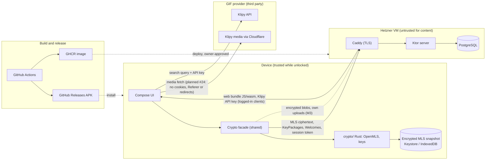

# Threat model (v1)

_This is a living document. Update it whenever a PR changes security assumptions; the security reviewer checks it each milestone. Report vulnerabilities as described in [`SECURITY.md`](../../SECURITY.md)._

## Assets
- GIF message content, meaning which GIF was sent in which chat.
- GIF search queries.
- Private keys (signature keys, MLS group secrets, local storage keys).
- Social graph: who talks to whom and in which groups.
- Account credentials and session tokens; invite codes.

## Data flow and trust boundaries
Everything outside the **device** box is untrusted for content. Dashed lines are planned (M3) or one-off.

What crosses each boundary:
- **Device → VM:** message content only as MLS ciphertext (application messages and handshakes as `PrivateMessage`). Never plaintext, GIF URLs, search terms or private keys. Alongside it, account and control data: credentials and session token, invite codes, username and device registration with public keys, KeyPackages and claims, Welcomes, the DS envelope (group ID, device list, epoch), inbox acks/read cursors, blob requests (M3) and push tokens (later). What this reveals is listed under *Known metadata visible to the server*.
- **VM → device:** relayed ciphertext, the web client code (see Accepted risks) and the Klipy API key. Each is untrusted: ciphertext is authenticated by MLS. Planned in #23: the key is checked for format and used only with the hard-coded provider host.
- **Device → GIF provider:** search terms and media fetches, directly from the client (ADR-0003). The provider sees the IP addresses.
- **Build → device/VM:** see the supply-chain row.

## Adversaries
| Adversary | Capabilities | In scope? |
|---|---|---|
| Curious or compromised **server / VM operator** | Reads the DB and traffic, can modify server code, can inject, drop, reorder or withhold messages | ✅ A **passive** server must not learn content or GIF identity. ⚠️ An **active** server can man-in-the-middle a first contact until key verification exists (see Accepted risks). Forged messages are detected by MLS; dropping, withholding and forking are *not* prevented (see Limitations). |
| **Network attacker** | Passive or active on the client↔server path | ✅ |
| **Malicious group member / friend** | Valid member who may misbehave | ✅ After removal they cannot read messages from later epochs. |
| **GIF provider** (Klipy, and Cloudflare in front of its CDN; ADR-0003) | Sees search queries and the sender's IP, and every recipient's IP and the GIF when they load it (Mode B′). Controls which bytes its CDN serves, including different bytes per recipient or hostile files aimed at image decoders. Can remove GIFs, shut down, or revoke our shared API key | ⚠️ Accepted leak (ADR-0003). Our server never sees GIF identity or searches. Recipients only fetch URLs on the provider's media hosts (strict allowlist), with no cookies, `Referer`, redirects or `customer_id`. Our own bounded scanner checks the file structure before any decoder runs, and decoding uses decoders that get security updates (see Assumptions); outdated Android phones get tap-to-load. A removed GIF shows a placeholder |
| **Stolen or unlocked device** | Full access to the app's local state | ⚠️ Partially: OS keystore protection; no defence against an unlocked device |
| **Malicious group member** (active) | Sends envelope/Commit mismatches, spams commits | ⚠️ Can deny service to a group (stuck/forked). Recovery is a new group (ADR-0002). Cannot read groups it was never in. |
| **Crafted MLS input** (from a member or replayed by the server) | Malformed KeyPackages, Welcomes or messages that make OpenMLS or our wrapper panic or misbehave | ⚠️ In place: `panic = "unwind"` on Android turns a panic into an exception. Planned in #11: catching wasm traps on the web (re-instantiate and restore), never persist state after a panic (reload the last snapshot), quarantine a message that keeps failing, per-group state, fuzzing of the parse paths, and errors mapped to closed codes so no key material reaches logs (spikes #3, #4). |
| **Local state rollback** (backup restore, crash, copied profile) | Restores an older MLS snapshot | ⚠️ In place: Android backup excluded. Planned in #11/#16: persist before send and before ack, atomic writes, no old snapshots, and freshness anchored at the Delivery Service, because an epoch check alone misses a rollback within an epoch (spikes #3, #4; ADR-0002). Without this, a restore can reuse ratchet keys and nonces. |
| **Prompt injection against AI agents** | Anyone can write issues, PR comments, or content agents read (dependency docs, API responses) on this public repo | ⚠️ Only owner-authored text counts as instructions (CLAUDE.md rule 7). There is no separate bot identity (owner decision 2026-10-13), so the agent technically has the owner's merge and settings power; the guard is the hard rule in CLAUDE.md plus the deny list (see Accepted risks). |
| **Supply chain / build pipeline** | Compromised dependency, GitHub Action, GHCR image, deploy SSH key, APK signing key, or web bundle | ✅ Pinned actions, committed lockfiles (Gradle, Cargo, Yarn), secret scanning with push protection, CodeQL (`security-extended`; Actions, Kotlin, Rust; Rust dependencies fetched `--locked`, then extracted offline; `wasm_api.rs` gets syntax-only analysis because it compiles only for wasm32), a CI repo-hygiene check (`scripts/check-repo-hygiene.sh`), shellcheck on every tracked `*.sh` (including `deploy.sh`) and actionlint on every workflow in CI (pinned, checksum-verified binaries; #48), SHA-256 dependency verification for every Gradle artifact (trust-on-first-use, no PGP yet), repositories restricted per group, Dependabot alerts, least-privilege workflow tokens, signing key held by the owner only. **Server deploys (#7):** the release build runs without any Actions or Gradle build cache. Registry credentials live in a separate job from Gradle. The image gets build provenance, and the deploy job verifies it (built by `deploy.yml` from `main` at that commit) before an owner-approved `production` deploy (admin bypass off). The VM runs it by digest, and CI's SSH key can only run `deploy.sh`, which accepts nothing but a validated commit/digest pair. Residual: approving a deploy runs that commit's compose and script as root-equivalent on the shared VM, and a compromised `main` deploys like any merge. The VM itself doesn't verify provenance: whoever holds the CI SSH key can deploy any image in the package, or an older commit's `deploy.sh`. The workflow's `main` guards live in the workflow file, so a dispatch on a branch can push an unreviewed image to the package; provenance verification and the environment's main-only rule still keep it from being deployed through CI. Base and Postgres images are digest-pinned and tracked by Dependabot. ⚠️ Dependabot's *Gradle* security PRs don't pass CI on their own: someone has to regenerate locks and checksums (docs/dependencies.md), so a Gradle security fix lands only as fast as that happens. |
| Global passive adversary / traffic analysis | | ❌ Out of scope for now |

## Security goals
1. Confidentiality and authenticity of message content against the network and a passive server. Against an active server this holds only for contacts whose keys were verified, or who were first contacted while the server was honest.
2. Forward secrecy and post-compromise security (recovery after a key compromise) as provided by MLS, with regular self-updates. Removed members lose access to later epochs. **Caveats:** FS does not cover the locally stored message history or the blob keys kept in it. Encrypted blobs (own uploads, M3) stay on the server until their TTL. OpenMLS `max_past_epochs` (kept small) retains old epoch secrets for late messages.
3. The server learns neither GIF identity nor search terms (ADR-0003).
4. Only invited people can register; invites are single-use and expire.
5. Users can detect key changes (M3: safety numbers).

## Limitations (not prevented)
- **An active server can hand each user a different GIF provider key** (spike #5). If the provider shows per-key analytics (not verified for Klipy), the operator could tie search terms to individual users. That breaks goal 3 against an *active* server. Possible later mitigation: group members compare a hash of the key over MLS.
- **GIF media isn't bound to the message (Mode B′):** MLS authenticates the media URL, not the bytes. The GIF provider/CDN can serve different content over time or per recipient.
- **A malicious member could learn when recipients load a GIF** if the provider offers uploaders view analytics (not verified for Klipy) and the member uploads a GIF there.
- The server can **drop, delay, withhold or reorder** messages. It can also show different members different views of a group (**forking**, e.g. by delivering conflicting commits to different members). MLS makes forged messages impossible, but it does not guarantee delivery or consistency. A later partial mitigation: clients compare the epoch authenticator or transcript hash, out of band or in-band.

- **Web client at rest (spike #4, corrected by SEC-1 on #37):** MLS state in the browser (identity key, all group secrets) is a snapshot in IndexedDB.
  - **A non-extractable WebCrypto key does *not* protect it against offline access to the profile:** Chromium and Firefox store the key's raw bytes on disk next to the ciphertext. Non-extractability is only enforced through the JS API; Safari/WebKit is the exception and wraps stored keys with the Keychain.
  - **Without a user passphrase**, anyone with a copy of the browser profile (backup, stolen laptop, malware) can decrypt all of it.
  - **Script running in our origin** (XSS, a compromised or maliciously served bundle) can use any key and read wasm/JS memory, passphrase or not.
  - **Mitigations:** optional passphrase-derived key (Argon2id inside the crate; protection is proportional to passphrase strength, since a copied profile allows unlimited offline guessing), strict CSP and SRI, and the phone app (Keystore) as the stronger client.
  - **Not yet signed off as an accepted risk:** this goes to the owner with #16.

## Accepted risks (owner sign-off required)
| Risk | Until | Mitigation planned |
|---|---|---|
| Active server serves a forged KeyPackage on first contact (MITM), or adds ghost devices | Key verification ships | M2: fingerprint display + in-chat "member/device added" notices; M3: safety-number verification and key-change warnings |
| AI agent uses the owner's GitHub account, so it technically has the ruleset admin bypass and could push to or merge into `main`. **Since #7 it could also dispatch the deploy workflow and approve a pending deployment through the API**: GitHub can't tell the agent from the owner | A bot account or GitHub App exists | Hard rule in `CLAUDE.md` (incl. never dispatching or approving deployments), deny list in `.claude/settings.json` as a backstop with known gaps (it blocks `gh workflow run`, `gh run rerun` and the common REST/GraphQL routes to dispatch, re-run or approve, plus `gh auth token`, but can't cover every way to use the token), owner reviews every PR and approves every deploy |
| Web client code is served by the untrusted server | Indefinitely (inherent to web E2EE) | Evaluate SRI / reproducible builds in a milestone review |
| **Shared VM** (ADR-0005): the GifItUp server shares its host, Docker daemon and TLS-terminating Caddy with the owner's other services. A compromise of any of them (or of a Docker management UI) is a GifItUp server compromise: metadata, availability, and the web client code it will serve. The `deploy` user is in the `docker` group, which is root-equivalent. **Any container on the shared `proxy` network**, with no escape or Docker access needed, can call the server directly (skipping Caddy's limits, forging `X-Forwarded-For`) and can register the same DNS alias to receive part of the traffic after TLS: session tokens, invite codes, KeyPackages, ciphertext (#46 SEC-1; owner chose to keep the shared network) | A separate VM is justified (revisit before the friends alpha, #27) | Per-container hardening, no published ports, internal-only Postgres, restricted CI SSH key (#7), hardening checklist (`docs/ops/vm-setup.md`); owner keeps the other services patched and their admin UIs off the public internet. Required in #12: the server enforces its own size and rate limits and trusts `X-Forwarded-For` only from Caddy |
| The GIF API key is shared by all clients. Our server hands it only to authenticated users, but a member could extract and abuse it and get it revoked, which stops GIF search for everyone until rotation (spike #5) | Indefinitely (inherent to a client-side key); owner wants to revisit it for improvements later | Key never built into the APK or web bundle; server-side rotation without a release (runbook in `docs/spikes/gif-provider.md`); production key with no hourly limit |

Owner sign-off: ☑ accepted by @paul-learning, 2026-10-13 (in chat with the agent: "i sign accept the risk")

Owner sign-off (AI-agent row extended to deploys, #7): ☑ accepted by @paul-learning, 2026-10-14 (in chat with the agent: "signed off")

Owner sign-off (shared VM row): ☑ accepted by @paul-learning, 2026-10-14 (answer in chat with the agent: "Yes, I accept it"; network: "Stay on `proxy`, document it")

Owner sign-off (shared GIF API key row): ☑ accepted by @paul-learning, 2026-10-14 (in chat with the agent: "yes i accept that risk - maybe we can improve it in the future")

## Known metadata visible to the server
- Usernames, devices, IP addresses, connection times.
- Group IDs, group membership (explicit by design, ADR-0002), message counts, timing, and ciphertext and blob sizes (blobs: own uploads, M3). Blob sizes are padded, and MLS application messages are padded to 256-byte blocks (spike value, final size set in #11/#24).
- Invite tree (who invited whom).
- KeyPackage claims (who is about to add whom), Welcome recipients, which device downloads which blob and when, inbox acks/read cursors, and push-notification tokens and timing once push exists.
- _(Not visible to the server, but to the GIF provider:)_ in Mode B′ the provider can link a sender's search to the recipients fetching the same GIF shortly after, and sees how many people load it from which IPs.

## Assumptions
- OpenMLS and the platform CSPRNGs are correct.
- The **image decoders** (GIF, WebP) are kept patched. Every recipient decodes provider media automatically (zero-click), in the process that holds the MLS keys (spike #5).
  - **Android:** OS decoders, patched only through OEM security updates, not Mainline. **This doesn't hold on phones out of support.** Mitigation: a security patch level older than 12 months switches received GIFs to tap-to-load (#24). A user who taps still runs the old decoder; that is the user's choice.
  - **Web:** the browser's decoders by default. If #24 has to fall back to Compose's bundled Skiko codecs, *we* are responsible. The owner watches Compose releases and Skia/libwebp/giflib advisories (also checked in milestone security reviews), ships an update within 14 days of a codec CVE, and otherwise switches the web client to tap-to-load.
  - The scanner and decode limits only stop resource exhaustion and malformed containers, not codec bugs inside the image data.
- The TLS-terminating proxy (Caddy) runs on the same VM and is **shared with the owner's other services** (ADR-0005). The server is still treated as untrusted for content. Whoever controls that Caddy, the Docker daemon or another service on the VM through a container escape controls the GifItUp server (see Accepted risks).
- The APK is distributed through GitHub Releases. The web client is served by the server we distrust (see Accepted risks).

## Open questions
- Web key storage: partly answered by spike #4 (see Limitations). Open: whether to offer an optional passphrase (Argon2id, with a minimum strength) for real stolen-profile protection. That's a product decision for #16.
- Push notifications: which provider, and what metadata does it reveal?
- Where the MLS snapshot is encrypted (#11): inside Rust with a platform-supplied key (preferred, so the plaintext snapshot never enters the Kotlin/JS heap), or in Kotlin/JS. If not inside Rust, the plaintext-in-heap exposure becomes an accepted risk here (spikes #3, #4).
